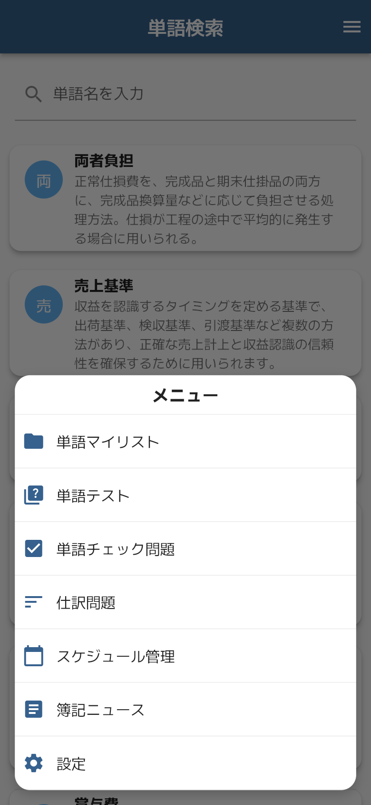
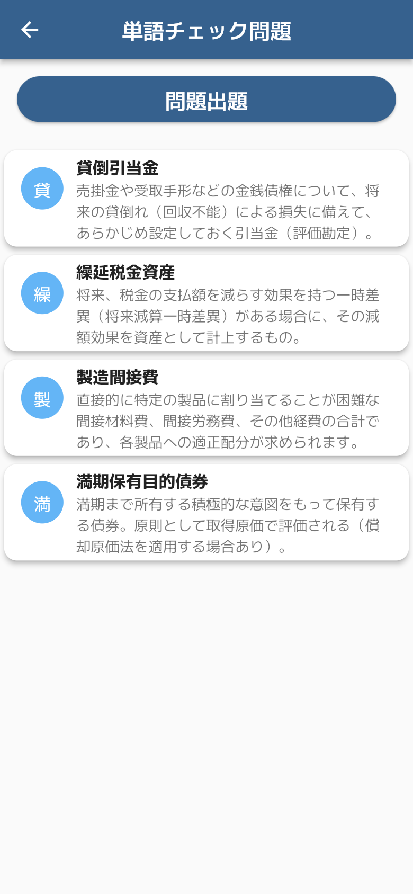
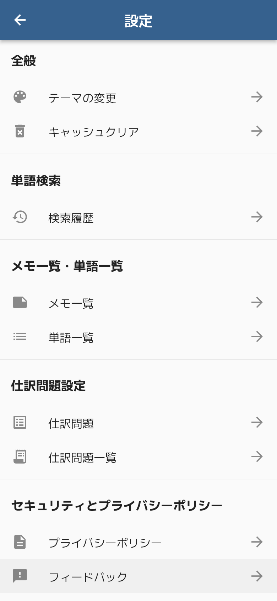
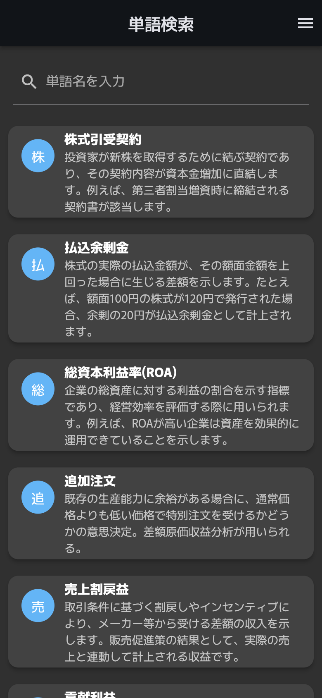

# 簿記単 — 3 分で読める概要

簿記用語 1,373 語と仕訳問題 270 問を収録した、簿記学習者向けの単語帳アプリです（Flutter / Android）。
「調べる → 覚える → 試す → 計画する」を 1 つのアプリで完結させ、オフラインでも主要機能が動きます。

| 項目 | 内容 |
| --- | --- |
| 種別 | 個人開発のモバイルアプリ（Flutter / Dart、状態管理は Riverpod） |
| 開発時期 | 2025-05〜2025-07（初期開発）、2026-07・2026-10（改修・リリース準備・ドキュメント整備）※コミット記録による |
| 規模 | `lib/` 75 ファイル・約 8,300 行、画面 33（ダイアログ・ボトムシート含む）、自動テスト 34 件（`test/` 約 500 行） |
| 開発体制 | 1 人。Claude Code を使って開発（詳細は [README の「開発について」](../README.md#開発について-development)） |

## 文書

| 文書 | 内容 |
| --- | --- |
| [要件定義書](requirements.md) | 目的・対象範囲、機能要件（FR-xx）、非機能要件 |
| [画面定義書](screen-definitions.md) | 画面一覧と、画面ごとの表示項目・操作・入力チェック・遷移先 |
| [詳細設計書](design/README.md) | アーキテクチャ、データ・状態管理、処理設計、広告・外部連携（Mermaid の UML 図 32 点） |
| [テスト報告書](test-report.md) | 自動テスト 34 件の内容と実行結果 |
| [リリース手順](../RELEASE.md) | 署名・広告 ID の設定、ビルド、ストア申告内容 |

## 伝えたいこと

1. **自分の困りごとから仕様を決めた** — 参考書の索引に無い用語をすぐ引けること、覚えた単語をそのまま試せることを軸に、検索・マイリスト・4 択テスト・仕訳問題・受験日管理までを 1 本の流れにしました。
2. **「正しく答えたのに不正解」を出さない** — 学習アプリでは問題データの誤りが致命的です。同梱データを直接検証するテスト（貸借一致・ID 重複など）を用意し、実際に誤りのある問題を見つけて修正しました。
3. **消去法で解けない問題にする** — 仕訳問題の勘定科目の選択肢を「その問題の正解だけ」から「全問題の科目から誤答候補を混ぜた最低 10 択・並べ替え済み」に変え、選択肢から答えが推測できないようにしました。
4. **ユーザーのデータを失わない・外に出さない** — 学習データはすべて端末内に保存し、起動直後の操作や壊れた保存データでも既存データを消さない作りにしています。

## 技術的課題と解決

| 課題 | 原因 | 解決 | 確認方法 |
| --- | --- | --- | --- |
| 起動直後に操作すると、保存済みのマイリスト・チェック・テーマが消える／巻き戻る | 各 Notifier が `shared_preferences` からの非同期読み込みを待たずに更新・保存していた。遅れて届いた読み込み結果が新しい状態を上書きしていた | 読み込み処理の `Future`（`_loaded`）を保持し、更新系メソッドは必ず `await _loaded` してから状態を変える | `persisted_notifiers_test.dart` の「読み込み完了前の更新」3 件 |
| 仕訳問題で、正しく答えても不正解になる問題があった | 問題データの借方合計と貸方合計が一致していなかった（手入力データの誤り） | 該当問題を修正し、配布する `assets/siwake.json` をそのまま読み込んで貸借一致・ID 重複・出題範囲を検証するテストを追加 | `bundled_data_test.dart` 5 件 |
| 仕訳問題が消去法で解けてしまう | 勘定科目の選択肢がその問題の正解だけで構成されていた | 全問題から勘定科目のマスタを作り、誤答候補を混ぜて最低 10 件にしたうえでソートして提示（`buildAccountChoices`） | `account_options_provider_test.dart` 6 件 |
| 起動時に画面がもたつく | 約 500KB の単語 JSON と約 190KB の仕訳 JSON を UI スレッドでパースしていた | パースを `compute()` で別 isolate に移し、結果は `FutureProvider` でキャッシュ | `asset_parsing_test.dart`（パース関数を単体で検証） |
| 同名のリスト・単語ができて挙動がおかしくなる | マイリスト・メモ・ミス回数を単語名／リスト名で紐付けているのに、名前の重複を防いでいなかった | リスト名の変更・カスタム単語の追加で、既存（収録単語を含む）と重複する名前を拒否 | `persisted_notifiers_test.dart` の重複 3 件 |
| ニュース記事の WebView から不正なページを開くおそれ | 外部由来の URL を JavaScript 有効・遷移先無制限で開いていた | `http` / `https` 以外のスキームを遮断、カメラ・マイク・位置情報の要求を拒否、表示中ドメインを常時表示 | コードレビュー（自動テストなし） |
| 公開リポジトリに収益用の広告 ID を置きたくない | ID をソースに直書きしていた | 広告ユニット ID は `--dart-define-from-file`、アプリ ID は `android/admob.properties` で注入。未設定時は Google のテスト用 ID にフォールバック | 追跡対象の ID がすべてテスト用であることを確認 |

## 主要画面のスクリーンショット

| 単語検索（ホーム） | メニュー | 単語の詳細 |
| --- | --- | --- |
|  |  |  |
| 起動直後の画面。検索欄が空のときはおすすめの単語を表示する | 右上のボタンから各機能へ移動する | 単語をタップすると説明を表示。メモの記入や画像での共有ができる |

| 単語マイリスト | 単語テスト | 単語チェック問題 |
| --- | --- | --- |
|  |  |  |
| 単語を自由にグループ化して保存する | 説明文から正しい単語を選ぶ 4 択クイズ | チェックした単語だけで出題する |

| 仕訳問題 | スケジュール管理 | 設定 |
| --- | --- | --- |
|  |  |  |
| 借方・貸方の勘定科目と金額を入力して解答する | 受験日までの残り日数と、日ごとの学習予定を管理する | テーマ・キャッシュクリア・各種一覧への入口 |

| ダークモード |
| --- |
|  |
| 設定 > テーマの変更 で切り替えられる |

### 撮影条件

- Flutter Web のリリースビルドを Chromium で表示して撮影（画面サイズ 390×844、2 倍解像度）
- マイリスト・チェック問題・スケジュールなどは、見本用のデータを入れた状態で撮影
- 次の点は Android 版と異なる
  - 広告は表示されない（広告 SDK が Web に対応していないため）
  - 簿記ニュースは掲載していない（Web ではブラウザの制約で RSS を取得できないため）
