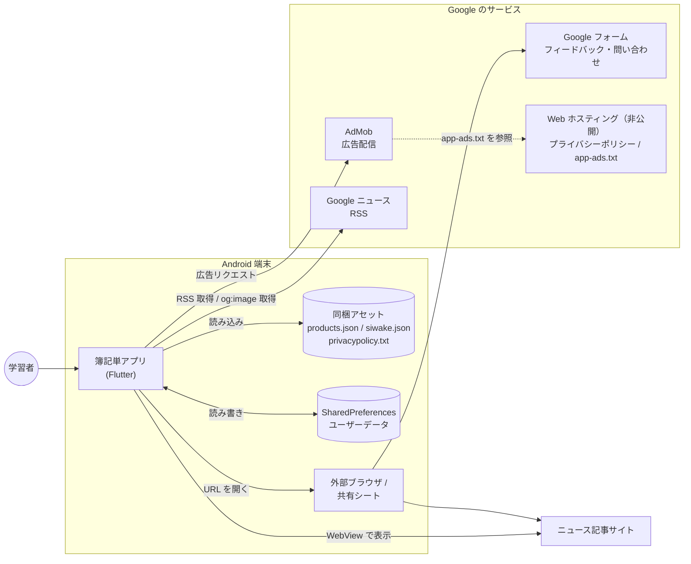
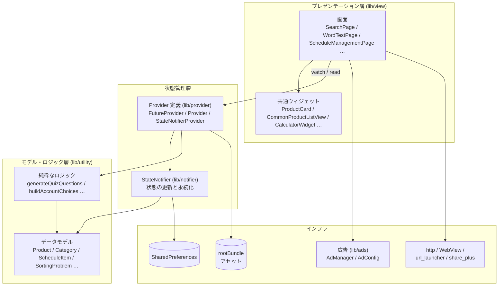
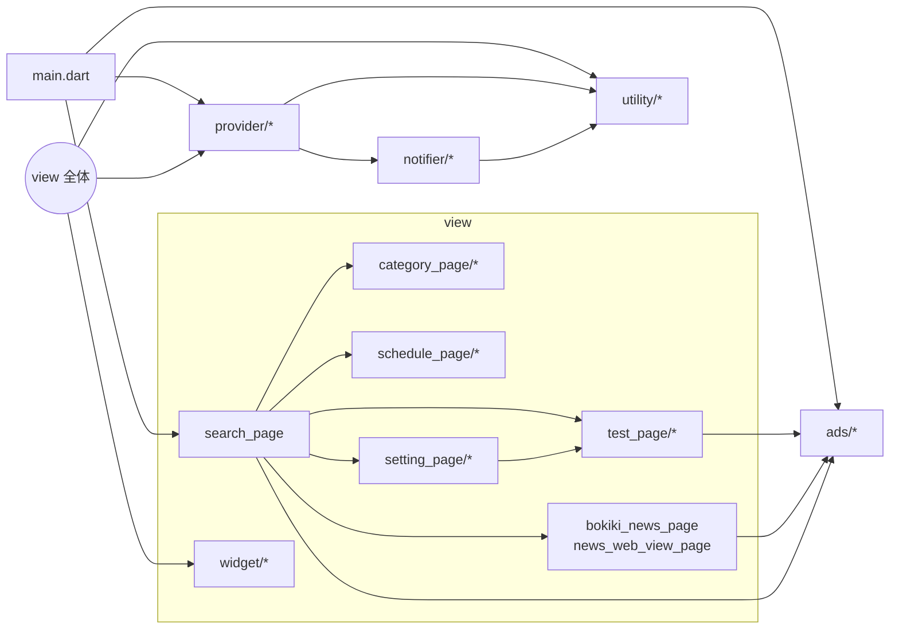
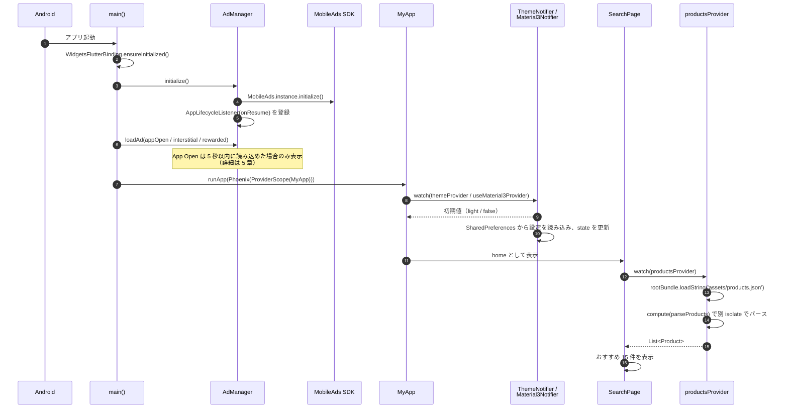

# 1. アーキテクチャ

[目次へ戻る](README.md)

## 1.1 システム概要

簿記単は、簿記の資格学習者向けのスタンドアロン型モバイルアプリです。
単語・仕訳問題のデータはアプリに同梱し、ユーザーが作ったデータ（マイリスト・メモ・スケジュールなど）は
すべて端末内（SharedPreferences）に保存します。**自前のサーバーは持たず、ユーザーデータを外部へ送信しません。**
ネットワークを使うのは、広告・簿記ニュース・外部リンク（フィードバックフォーム等）だけです。

## 1.2 システム構成図



| 外部要素 | 用途 | 通信内容 |
| --- | --- | --- |
| AdMob | バナー・インタースティシャル・リワード・App Open 広告 | 広告 SDK が広告 ID 等を送信（[5 章](05_ads_and_external.md)） |
| Google ニュース RSS | 簿記ニュース一覧 | 検索語のみ（ユーザーデータは送らない） |
| ニュース記事サイト | 記事本文の閲覧（アプリ内 WebView） | 通常のページ閲覧 |
| Google フォーム | アプリのフィードバック、仕訳問題の誤り報告 | 外部ブラウザで開く。入力はユーザー自身が行う |
| Web ホスティング（本リポジトリには含めない） | プライバシーポリシーと `app-ads.txt` の公開 | アプリからは通信しない（Play と AdMob が参照） |

## 1.3 レイヤー構成

UI・状態・データの 3 層に分け、状態管理には Riverpod を使います。



| 層 | ディレクトリ | 責務 | 依存してよい先 |
| --- | --- | --- | --- |
| プレゼンテーション | `lib/view` | 画面の描画と操作の受付。画面遷移は `Navigator.push` / `MaterialPageRoute` | 状態管理層、モデル層、広告 |
| 状態管理（Provider） | `lib/provider` | Provider の定義。アセットの読み込みや派生データの計算 | Notifier、モデル層 |
| 状態管理（Notifier） | `lib/notifier` | 変更可能な状態の保持と、SharedPreferences への永続化 | モデル層、SharedPreferences |
| モデル・ロジック | `lib/utility` | データクラス、JSON 変換、UI に依存しないロジック、BuildContext 拡張 | なし（Flutter / Dart 標準のみ） |
| 広告 | `lib/ads` | 広告 SDK の初期化・読み込み・表示制御 | google_mobile_ads、SharedPreferences |

> **補足**: `lib/utility` には `MemoDisplay`・`SwipeToDeleteCard` などのウィジェットと、
> SharedPreferences を直接読む `loadMemo` も含まれます（歴史的経緯による配置）。

## 1.4 パッケージ図（主要な依存関係）



## 1.5 起動処理



- `Phoenix` はキャッシュクリア後にウィジェットツリーごと作り直す（アプリ再起動相当）ために使います。
  作り直しで `ProviderScope` も再生成されるため、全 Notifier が SharedPreferences から読み直します。
- アセットの読み込み（約 500KB の単語 JSON、約 190KB の仕訳 JSON）は `compute()` で別 isolate に逃がし、
  起動直後の UI のカクつきを防ぎます。

## 1.6 技術スタック

| 分類 | 採用技術 | バージョン（pubspec） | 用途 |
| --- | --- | --- | --- |
| フレームワーク | Flutter / Dart | Flutter 3.44 系 / Dart SDK `>=3.0.0 <4.0.0` | アプリ全体 |
| 状態管理 | flutter_riverpod | ^3.4.3 | Provider / StateNotifier（`legacy.dart`） |
| 永続化 | shared_preferences | ^2.5.3 | ユーザーデータの保存 |
| 広告 | google_mobile_ads | ^5.3.1 | AdMob |
| カレンダー | table_calendar | ^3.0.8 | スケジュール画面 |
| 電卓 | math_expressions | ^2.1.1 | 仕訳問題の金額入力補助 |
| 書式 | intl | ^0.20.2 | 金額の 3 桁区切り |
| 通信・解析 | http / xml | ^1.6.0 / ^6.1.0 | ニュース RSS の取得と解析 |
| WebView | webview_flutter / webview_flutter_android | ^4.2.2 | ニュース記事の閲覧 |
| 外部連携 | url_launcher / share_plus / path_provider | ^6.1.7 / ^11.0.0 / ^2.1.5 | 外部ブラウザ、単語カード画像の共有 |
| 再起動 | flutter_phoenix | ^1.1.1 | キャッシュクリア後の再起動 |
| フォント | Murecho（同梱） | — | 全画面の日本語表示 |

`flutter_slidable`（^3.1.2）と `html`（^0.15.0）は依存関係に含まれていますが、現在のコードでは使っていません。

Android のビルド設定: Gradle 8.14.3 / AGP 8.11.1 / Kotlin 2.2.20 / compileSdk 36 / **targetSdk 36** / minSdk 24。

## 1.7 ディレクトリ構成

```
lib/
├── main.dart                     # エントリーポイント（初期化とテーマ設定）
├── ads/                          # 広告
│   ├── ad_config.dart            #   広告ユニット ID（--dart-define で注入）
│   └── ad_manager.dart           #   読み込み・表示制御、BannerAdView
├── notifier/                     # StateNotifier（状態 + 永続化）10 クラス
├── provider/                     # Provider 定義 15 ファイル
├── utility/                      # モデル・ロジック・拡張
└── view/                         # 画面
    ├── search_page.dart          #   ホーム（単語検索）
    ├── word_list_page.dart       #   単語一覧・カスタム単語の追加
    ├── saved_items_page.dart     #   保存単語
    ├── bokiki_news_page.dart     #   簿記ニュース
    ├── news_web_view_page.dart   #   記事閲覧（WebView）
    ├── category_page/            #   マイリスト
    ├── schedule_page/            #   学習スケジュール
    ├── setting_page/             #   設定
    ├── test_page/                #   単語テスト・チェック問題・仕訳問題
    └── widget/                   #   共通ウィジェット・ダイアログ
assets/                           # 単語・仕訳問題・プライバシーポリシー・フォント・画像
test/                             # ユニットテスト・ウィジェットテスト
Doc/                              # ドキュメント（要件・画面定義・設計書・テスト報告書・スクリーンショット）
```

## 1.8 非機能設計

### 性能

| 対策 | 実装箇所 |
| --- | --- |
| アセット JSON のパースを別 isolate で実行 | `productsProvider` / `sortingProblemsProvider` の `compute()` |
| アセットは 1 度だけ読み込み、以降は Provider がキャッシュ | `FutureProvider` |
| 検索入力を 250ms デバウンスしてから絞り込む（入力を消したときは即時反映） | `SearchPage._onSearchChanged` |
| おすすめ 15 件は Provider でキャッシュし、再描画のたびに並びを変えない | `randomProductsProvider` |
| 出題内容はデータ到着時に 1 度だけ確定させる（再描画で問題が入れ替わらない） | 各クイズ画面の `_quiz ??= …` |
| ニュース一覧は `FutureProvider.family` でタブごとにキャッシュ | `newsArticlesProvider` |

### 信頼性・データ保全

| 対策 | 内容 |
| --- | --- |
| 読み込み完了待ち | 各 Notifier の更新処理は、保存済みデータの読み込み（`_loaded`）の完了を待ってから実行する。起動直後に操作しても保存済みデータを上書きしない（[4.9](04_logic.md#49-永続化-notifier-の読み込みと更新)） |
| 破損データの読み飛ばし | 保存データの JSON が壊れていても例外で止めず、壊れたレコード（またはキー）だけを読み飛ばす |
| 同梱データの検証 | `test/provider/bundled_data_test.dart` で仕訳の貸借一致、ID・単語名の重複などを検証する |
| 名前の一意性 | 単語・マイリストは名前で識別するため、重複する名前の追加・変更を拒否する |
| 端末移行 | `android:allowBackup="true"` により、Android の自動バックアップでユーザーデータを引き継げる |

### セキュリティ・プライバシー

| 対策 | 内容 |
| --- | --- |
| ユーザーデータの外部非送信 | メモ・マイリスト・スケジュール等は端末内にのみ保存する |
| WebView の URL 制限 | `http` / `https` 以外のスキーム（`javascript:`・`file:` 等）は読み込み・遷移とも拒否する |
| WebView の権限要求拒否 | 記事ページからのカメラ・マイク・位置情報の要求を一律で拒否し、メディアの自動再生もしない |
| 外部由来 URL の検証 | RSS のリンク・サムネイル・`og:image` の URL を `http(s)` に限定する |
| 広告 ID の外部化 | 本番の広告ユニット ID は `--dart-define-from-file` で注入し、リポジトリに置かない（秘密情報ではないが運用上の配慮） |
| 広告の誤クリック防止 | デバッグビルドでは常に Google のテスト用 ID を使う |

### 可用性（オフライン時の動作）

| 機能 | オフライン時 |
| --- | --- |
| 単語検索・単語テスト・仕訳問題・マイリスト・スケジュール・設定 | すべて利用できる（同梱データと端末内データのみ使用） |
| 簿記ニュース | 取得に失敗し、エラーと「再読み込み」ボタンを表示する（1 回の取得は 10 秒でタイムアウト。Riverpod 3 の既定により失敗した取得は自動で再試行される） |
| 広告 | 表示されない。広告が無くても画面遷移・再挑戦は継続する |

### 画面サイズ・テーマ

- 余白・文字サイズは `BuildContext` 拡張 `ResponsiveSizes`（`lib/utility/responsive_sizes.dart`）で画面幅に比例させます。
- テーマはライト・ダーク・端末設定に従う、の 3 種類。Material 3 の ON/OFF も切り替えられます（既定はライト、Material 3 は OFF）。

## 1.9 テスト

| ファイル | 対象 | 種別 |
| --- | --- | --- |
| `test/widget_test.dart` | ホーム画面の表示と検索 | ウィジェットテスト |
| `test/provider/asset_parsing_test.dart` | アセット JSON のパース | ユニット |
| `test/provider/bundled_data_test.dart` | 同梱データの整合性（貸借一致・重複・範囲キー） | ユニット |
| `test/provider/account_options_provider_test.dart` | 勘定科目の選択肢生成 | ユニット |
| `test/utility/generate_quiz_questions_test.dart` | 4 択クイズの生成 | ユニット |
| `test/utility/schedule_item_test.dart` | `ScheduleItem` の JSON 変換・`copyWith` | ユニット |
| `test/notifier/persisted_notifiers_test.dart` | 読み込み前の更新、名前の重複拒否、破損データ | ユニット |

実行: `flutter test` / 静的解析: `flutter analyze`

## 1.10 既知の課題

設計書作成時点で把握している、実装上の課題です。

| # | 内容 | 影響 | 該当箇所 |
| --- | --- | --- | --- |
| 1 | 受験日までの残り日数が `startTime.difference(now).inDays + 1` で、日付ではなく試験の開始時刻を境に変わる | 同じ日でも時刻によって表示が 1 日ずれる | `schedule_management_page.dart` |
| 2 | カレンダーにロケールを指定していないため、月名・曜日が英語表示 | 表示のみ | `schedule_management_page.dart` |
| 3 | 単語テスト・チェック問題・保存単語・メモ一覧は収録単語（`productsProvider`）だけを対象とし、カスタム単語を含まない | カスタム単語はテストに出題されず、メモ一覧にも出ない | 各画面 |
| 4 | 単語の分類名に表記揺れがある（例: `純資産（資本）` と `純資産(資本)`） | 単語一覧の分類フィルターに似た項目が並ぶ | `assets/products.json` |
| 5 | `SavedItemsPageState`（並び替えモード付き）が定義されているが使われていない | 保存単語の並び替え UI が表示されない（未使用コード） | `saved_items_page.dart` |
| 6 | `flutter_slidable`・`html` が依存関係にあるが未使用 | アプリサイズがわずかに増える | `pubspec.yaml` |
| 7 | メモ・ミス回数・マイリストは単語名で紐付けるため、収録単語の名前を変更すると過去データと紐付かなくなる | データ更新時の移行が必要 | 永続化設計（[3.4](03_data_and_state.md#34-永続化データ設計sharedpreferences)） |
