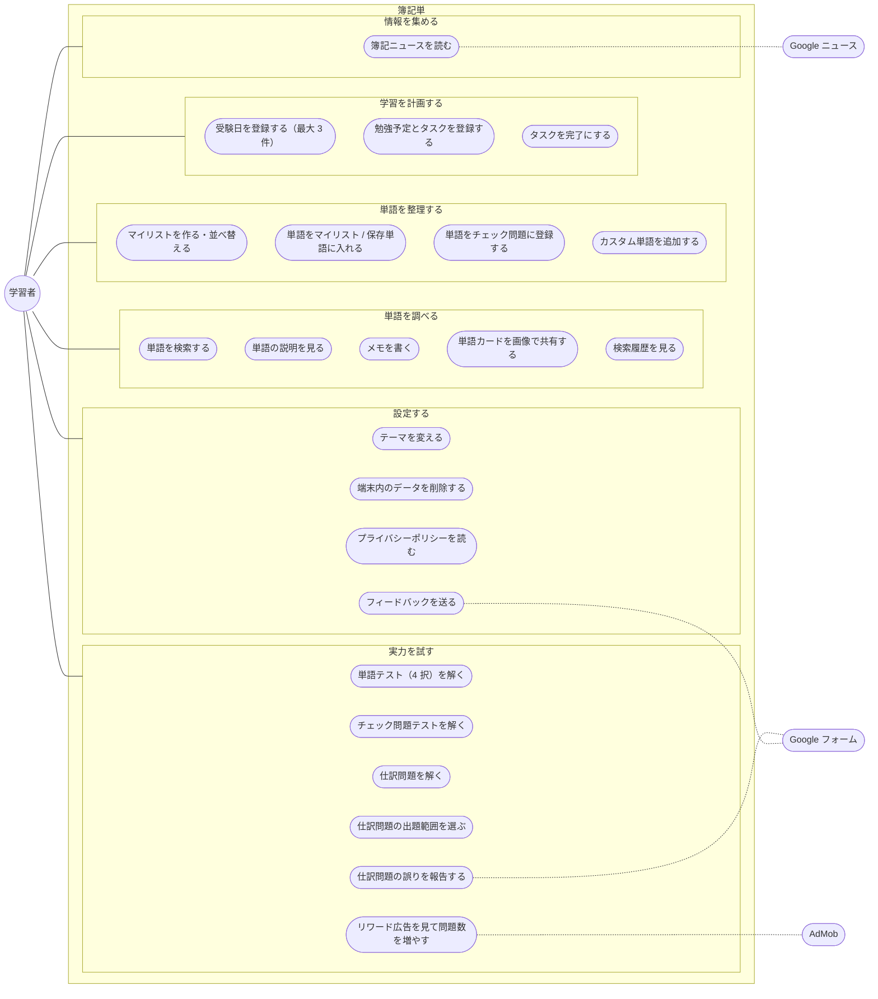
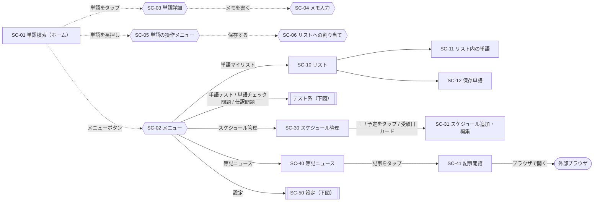
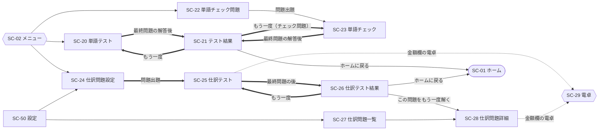
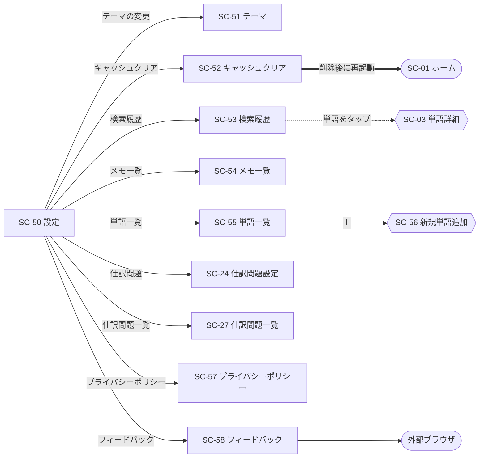

# 2. 機能・画面設計

[目次へ戻る](README.md)

## 2.1 ユースケース図

Mermaid にはユースケース図の専用記法がないため、フローチャートで表します（楕円がユースケース）。

## 2.2 画面一覧

| ID | 画面名 | 種別 | クラス / 関数 | ファイル（`lib/view/` 以下） |
| --- | --- | --- | --- | --- |
| SC-01 | 単語検索（ホーム） | 画面 | `SearchPage` | `search_page.dart` |
| SC-02 | メニュー | ボトムシート | `_SearchPageState._openMenu` | `search_page.dart` |
| SC-03 | 単語詳細 | ダイアログ | `showProductDialog` | `widget/show_product_dialog.dart` |
| SC-04 | メモ入力 | ダイアログ | `showMemoDialog` | `widget/show_memo_dialog.dart` |
| SC-05 | 単語の操作メニュー（長押し） | ボトムシート | `_SearchResultList._showActionSheet` ほか | `search_page.dart` ほか |
| SC-06 | リストへの割り当て | ボトムシート | `CategoryAssignmentSheet` | `category_page/category_assignment_sheet.dart` |
| SC-10 | リスト（マイリスト） | 画面 | `CategorySelectionPage` | `category_page/category_selection_page.dart` |
| SC-11 | リスト内の単語 | 画面 | `CategoryItemsPage` | `category_page/category_items_page.dart` |
| SC-12 | 保存単語 | 画面 | `SavedItemsPage` | `saved_items_page.dart` |
| SC-13 | 新規リスト作成 | ダイアログ | `showCategoryCreationDialog` | `widget/show_category_creation_dialog.dart` |
| SC-20 | 単語テスト | 画面 | `WordTestPage` | `test_page/word_test/word_test_page.dart` |
| SC-21 | テスト結果 | 画面 | `WordTestResultPage` | `test_page/word_test/word_test_result_page.dart` |
| SC-22 | 単語チェック問題（登録一覧） | 画面 | `CheckedQuestionsPage` | `test_page/check_test/checked_questions_page.dart` |
| SC-23 | 単語チェック（テスト） | 画面 | `CheckboxTestPage` | `test_page/check_test/checkbox_test_page.dart` |
| SC-24 | 仕訳問題設定 | 画面 | `JournalQuizSettingsPage` | `test_page/siwake_test/journal_quiz_settings_page.dart` |
| SC-25 | 仕訳テスト | 画面 | `JournalEntryQuizPage` | `test_page/siwake_test/journal_entry_quiz_page.dart` |
| SC-26 | 仕訳テスト結果 | 画面 | `SortingQuizResultPage` | `test_page/siwake_test/sorting_quiz_result_page.dart` |
| SC-27 | 仕訳問題一覧 | 画面 | `JournalProblemsListPage` | `test_page/siwake_test/journal_problems_list_page.dart` |
| SC-28 | 仕訳問題詳細 | 画面 | `JournalProblemDetailPage` | `test_page/siwake_test/journal_problem_detail_page.dart` |
| SC-29 | 電卓 | ボトムシート | `CalculatorWidget` | `widget/calculator_widget.dart` |
| SC-30 | スケジュール管理 | 画面 | `ScheduleManagementPage` | `schedule_page/schedule_management_page.dart` |
| SC-31 | スケジュール追加・編集 | 画面 | `AddEditSchedulePage` | `schedule_page/add_edit_schedule_page.dart` |
| SC-40 | 簿記ニュース | 画面 | `BokikiNewsPage` | `bokiki_news_page.dart` |
| SC-41 | 記事閲覧 | 画面 | `NewsWebViewPage` | `news_web_view_page.dart` |
| SC-50 | 設定 | 画面 | `SettingsPage` | `setting_page/settings_page.dart` |
| SC-51 | テーマ | 画面 | `ThemeSettingsPage` | `setting_page/theme_settings_page.dart` |
| SC-52 | キャッシュクリア | 画面 | `CacheClearScreen` | `setting_page/cache_clear_screen.dart` |
| SC-53 | 検索履歴 | 画面 | `SearchHistoryPage` | `setting_page/search_history_page.dart` |
| SC-54 | メモ一覧 | 画面 | `MemoListPage` | `setting_page/memo_list_page.dart` |
| SC-55 | 単語一覧 | 画面 | `WordListPage` | `word_list_page.dart` |
| SC-56 | 新規単語追加 | ダイアログ | `AddProductDialog` | `widget/add_product_dialog.dart` |
| SC-57 | プライバシーポリシー | 画面 | `PrivacyPolicy` | `setting_page/privacy_policy.dart` |
| SC-58 | フィードバック | 画面 | `FeedbackPage` | `setting_page/feedback_page.dart` |

スクリーンショットは [Doc/README.md](../README.md) を参照してください。

## 2.3 画面遷移図

画面遷移はすべて `Navigator`（`push` / `pushReplacement` / `popUntil`）で行います。名前付きルートは使っていません。
図が大きくなるため、全体・テスト系・設定系の 3 つに分けて示します。
実線は `push`、太線は `pushReplacement`（戻るボタンで元の画面に戻らない遷移）、点線はダイアログ・ボトムシートです。

### 全体

### テスト系

### 設定系

補足:

- 「ホームに戻る」は `Navigator.popUntil(route.isFirst)` で、スタックを先頭（SC-01）まで戻します。
- SC-52 の「削除後に再起動」は `Phoenix.rebirth` でアプリ全体を作り直します（スタックも初期化される）。
- 単語の操作メニュー（SC-05）は SC-01 のほか、SC-11・SC-12・SC-22 でも同様に表示します。
- SC-25 と SC-28 の解答欄は同じウィジェット `JournalEntryQuizWidget` を使います。

## 2.4 画面仕様

各画面の表示内容・操作・使う状態をまとめます。Provider の詳細は [3 章](03_data_and_state.md) を参照してください。

### SC-01 単語検索（ホーム）

| 項目 | 内容 |
| --- | --- |
| 目的 | 単語を名前・読みガナから検索し、説明を確認する |
| 表示 | 検索欄、検索結果（`ProductCard` のリスト）、画面下部にバナー広告 |
| 初期表示 | 検索欄が空のときは、収録単語とカスタム単語から無作為に 15 件（`randomProductsProvider`） |
| 検索 | 単語名または読みガナに、入力文字列が含まれるもの（大文字小文字を区別しない部分一致）。入力は 250ms デバウンス |
| 該当なし | 「一致する単語がありません」 |
| タップ | 検索履歴に追加し、単語詳細（SC-03）を開く |
| 長押し | 操作メニュー（SC-05）:「保存する」→ SC-06、「単語チェック問題に登録する」 |
| 右上ボタン | メニュー（SC-02） |
| 使用する状態 | `searchQueryProvider`、`productsProvider`、`customProductsProvider`、`randomProductsProvider`、`searchHistoryProvider`、`checkedQuestionsProvider` |

### SC-02 メニュー

ホームから各機能へ移動するボトムシート。項目は「単語マイリスト」「単語テスト」「単語チェック問題」「仕訳問題」「スケジュール管理」「簿記ニュース」「設定」の 7 つ。

### SC-03 単語詳細 / SC-04 メモ入力

| 項目 | 内容 |
| --- | --- |
| 表示 | 単語名、説明、保存済みのメモ（`memo_<単語名>`） |
| 共有ボタン | ダイアログを画像化し、共有シートで共有する（[4.10](04_logic.md#410-単語カードの画像共有)） |
| メモを書く | SC-04 を開き、保存後にダイアログ内のメモ表示を更新する |
| メモの保存 | 前後の空白を除いて `memo_<単語名>` に保存。「メモが保存されました」を表示 |

### SC-06 リストへの割り当て

| 項目 | 内容 |
| --- | --- |
| 表示 | 全リストのチェックボックス（現在の所属を反映）、「保存単語一覧」のチェックボックス（初期値 ON）、「新規リスト追加」 |
| 確定 | 完了ボタンで、チェック状態に応じてリストへの所属と保存単語を一括で更新する（チェック操作の時点では保存しない） |

### SC-10 リスト / SC-11 リスト内の単語 / SC-12 保存単語

| 画面 | 主な操作 |
| --- | --- |
| SC-10 | 「保存単語一覧」への入口、リストの一覧（登録単語数を表示）、＋で新規作成（SC-13）、長押しで「名前の変更」「削除」「並び替え」 |
| SC-11 | リスト内の単語一覧（収録単語＋カスタム単語から名前で引く）。タップで詳細、長押しで保存・チェック問題登録・並び替え・削除、スワイプで削除 |
| SC-12 | 保存単語の一覧。タップで詳細、スワイプで削除（確認あり）、長押しで操作メニュー |

入力チェック:

| 対象 | ルール | エラー表示 |
| --- | --- | --- |
| リスト名（新規・変更） | 空白のみ不可、最大 30 文字、既存のリスト名と重複不可 | 入力欄の下に「リスト名を入力してください」「同じ名前のリストが既にあります」 |

### SC-20 単語テスト / SC-21 テスト結果

| 項目 | 内容 |
| --- | --- |
| 出題 | 収録単語から無作為に 10 問（再挑戦時はリワード広告の視聴で＋10 問） |
| 問題 | 単語の説明文を表示し、単語名を 4 択で選ぶ |
| 解答 | 選択すると正解を緑、誤答を赤で表示。不正解ならミス回数を＋1。1 秒後に次の問題へ |
| 終了 | 最終問題の後にインタースティシャル広告（表示間隔の上限あり）→ SC-21 |
| 結果 | 正解数 / 問題数、問題ごとの正誤・問題文・選択肢・ミス回数。選択肢をタップするとその単語の説明を表示。「ホームに戻る」「もう一度」 |
| もう一度 | 単語テストはリワード広告を表示し、報酬を得たら問題数＋10、得なければ同じ問題数で再挑戦。チェック問題テストは広告なしで再挑戦 |

### SC-22 単語チェック問題 / SC-23 単語チェック

| 項目 | 内容 |
| --- | --- |
| SC-22 | 登録済みの単語の一覧と「問題出題」ボタン。スワイプで登録解除（確認あり）、長押しで保存・削除 |
| SC-23 の出題 | 登録済みの単語（収録単語に含まれるもの）から最大 10 問。誤答の選択肢は収録単語全体から選ぶ |
| 登録が 0 件 | 「チェックされた問題がありません」 |
| 以降の流れ | SC-20 と同じ（結果画面は SC-21 を共用） |

### SC-24 仕訳問題設定

| 項目 | 内容 |
| --- | --- |
| 表示 | 出題範囲のチェックボックス 3 つ（簿記3級-商業簿記 / 簿記2級-商業簿記 / 簿記2級-工業簿記）。初期値はすべて ON |
| 保存 | チェックを変えるたびに `journal_quiz_filters` に保存 |
| 問題出題 | 1 つも選択していないときは押せず、「出題範囲を1つ以上選択してください。」を表示。押すと SC-25 に置き換えて遷移 |

### SC-25 仕訳テスト / SC-29 電卓

| 項目 | 内容 |
| --- | --- |
| 出題 | 出題範囲に合う問題から無作為に 10 問（再挑戦時はリワードで＋5 問） |
| 表示 | 問題番号 / 総数（簿記の種別）、問題文、借方・貸方の入力欄（正解の行数ぶん）、「回答を提出」 |
| 入力欄 | 勘定科目（ドロップダウン）と金額（3 桁区切りで自動整形）。金額欄の電卓ボタンで SC-29 を開き、計算結果を入力欄に反映 |
| 勘定科目の選択肢 | 正解の科目に、全問題の勘定科目から無作為に選んだ誤答候補を加えて最低 10 件にし、五十音（コード順）に並べる |
| 採点 | 借方・貸方それぞれで、科目と金額の組が順不同で完全一致すれば正解（[4.5](04_logic.md#45-仕訳問題の採点)） |
| 未入力 | 「借方のすべての項目を入力してください」などを表示して採点しない |
| 右上ボタン | 問い合わせ（問題 ID をコピーしてから Google フォームを開く） |
| 終了 | 最終問題の後にインタースティシャル広告 → SC-26 |

### SC-26 仕訳テスト結果 / SC-27 仕訳問題一覧 / SC-28 仕訳問題詳細

| 画面 | 内容 |
| --- | --- |
| SC-26 | 問題ごとの正誤・正解仕訳・解説。各問題から SC-28 へ移動できる。「ホームに戻る」「もう一度」 |
| SC-27 | 全 270 問の一覧。タップで SC-28 |
| SC-28 | タブ「問題内容」（SC-25 と同じ解答 UI で解ける）と「解説」（正解仕訳と解説文） |

### SC-30 スケジュール管理 / SC-31 スケジュール追加・編集

| 項目 | 内容 |
| --- | --- |
| 受験日カード | 今後の受験日を日付順に最大 3 件。「受験日まで N 日」を表示。タップで編集 |
| カレンダータブ | 月表示のカレンダー（予定のある日に印）。選択した日の予定を下に表示。＋で選択日の予定を追加 |
| タスク一覧タブ | 未完了のタスクを「過去 / 本日 / 未来」に分け、完了したものは「完了タスク」にまとめる |
| 予定の操作 | タップで編集（SC-31）、長押しで「完了とする / 未完了に戻す」「タスクを削除」 |
| SC-31 の入力 | 種別（勉強タスクを設定する / 受験日として設定する）、タイトル（必須）、詳細、開始・終了日時、タスク（カンマ区切り。勉強予定のみ）。編集時は削除ボタンも表示 |
| SC-31 の制約 | 勉強予定は終了日時が開始日時より後であること。受験日は今後の日付で最大 3 件まで（超えると「受験日の設定制限」ダイアログ）。受験日の終了日時は開始の 7 日後、タスクは空で保存する |

### SC-40 簿記ニュース / SC-41 記事閲覧

| 項目 | 内容 |
| --- | --- |
| タブ | 簿記３級 / 簿記２級 / 簿記１級 / 会計関連（検索語: `簿記+3級` / `簿記+2級` / `簿記+1級` / `会計`） |
| 記事一覧 | タブごとに Google ニュース RSS から取得し、無作為に並べ替えて 15 件。サムネイルが無い記事は記事ページの `og:image` で補う |
| 更新 | 引っ張って更新、またはエラー時の「再読み込み」 |
| 記事を開く | インタースティシャル広告（表示間隔の上限あり）の後、SC-41 で記事を表示 |
| SC-41 | アプリ内 WebView。表示中のドメインをタイトル下に表示。「ブラウザで開く」で外部ブラウザへ |

### SC-50 設定と配下の画面

| 画面 | 内容 |
| --- | --- |
| SC-50 設定 | 「全般」「単語検索」「メモ一覧・単語一覧」「仕訳問題設定」「セキュリティとプライバシーポリシー」の 5 区分で各画面へのリンクを表示 |
| SC-51 テーマ | ライト / ダーク / 端末の設定に従う、の選択と Material 3 の ON/OFF。即時に反映して保存 |
| SC-52 キャッシュクリア | 削除する項目を選び（「すべて削除」あり）、確認後にインタースティシャル広告（表示間隔の上限あり）を挟んで削除し、アプリを再起動（[4.8](04_logic.md#48-キャッシュクリア)） |
| SC-53 検索履歴 | ホーム（SC-01）で単語詳細を開いた単語の履歴（新しい順、最大 15 件）。タップで詳細、全削除できる |
| SC-54 メモ一覧 | メモを書いた単語の一覧。メモを個別に削除できる |
| SC-55 単語一覧 | 収録単語＋カスタム単語の一覧。分類でフィルターできる。＋でカスタム単語を追加（SC-56） |
| SC-56 新規単語追加 | 単語（必須）・読みガナ・説明を入力。収録単語・カスタム単語と同じ名前は追加できない |
| SC-57 プライバシーポリシー | `assets/privacypolicy.txt` を表示 |
| SC-58 フィードバック | Google フォームを外部ブラウザで開く |
