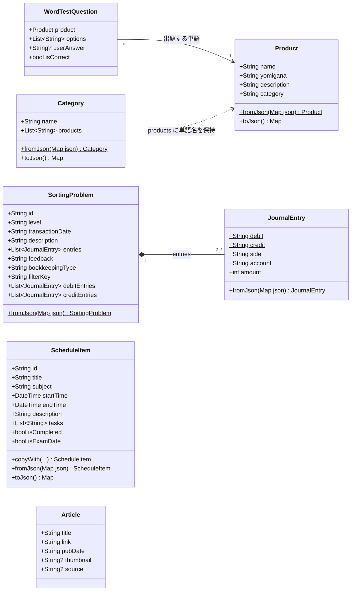
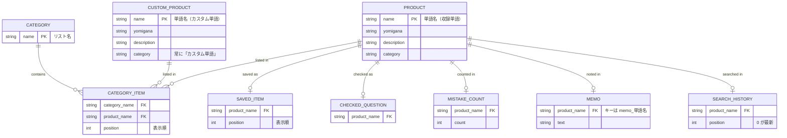
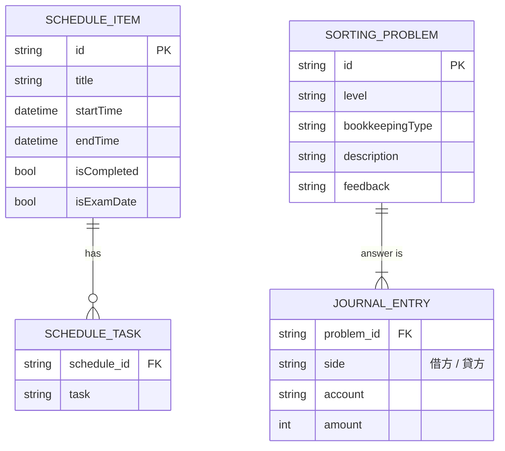
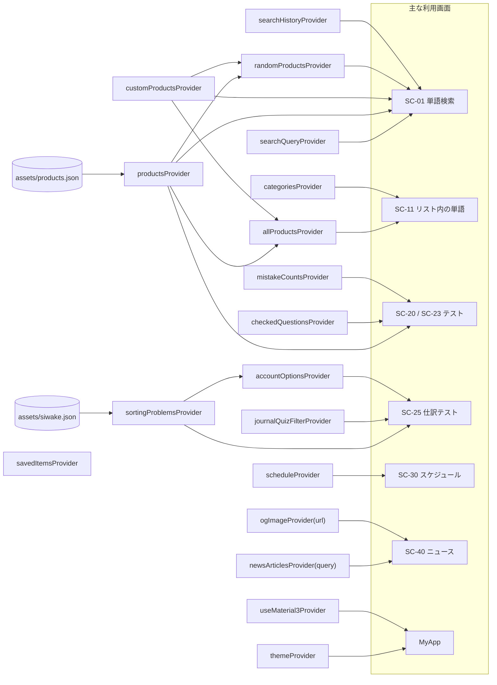
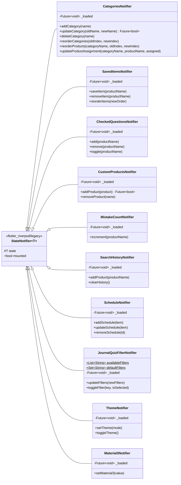

# 3. データ・状態管理設計

[目次へ戻る](README.md)

## 3.1 データの全体像

アプリが扱うデータは、出どころで 3 種類に分かれます。

| 種類 | 保存場所 | 変更 | 例 |
| --- | --- | --- | --- |
| 同梱データ | `assets/`（アプリに同梱） | アプリの更新でのみ変わる（読み取り専用） | 収録単語、仕訳問題、プライバシーポリシー |
| ユーザーデータ | SharedPreferences（端末内） | ユーザーの操作で変わる | マイリスト、メモ、スケジュール、設定 |
| 一時データ | メモリのみ | 画面を閉じると消える | 出題中のクイズ、検索語、ニュース記事 |

**単語は名前（`Product.name`）で識別します。** マイリスト・保存単語・チェック問題・ミス回数・メモ・検索履歴は、
いずれも単語オブジェクトではなく単語名を保存し、表示時に単語一覧から名前で引き直します。
このため、単語名は収録単語とカスタム単語を通して一意でなければなりません（重複する名前の追加は拒否する）。

## 3.2 クラス図（データモデル）

`lib/utility/` のデータクラスと、ニュース記事の `Article`（`lib/view/bokiki_news_page.dart`）です。



| クラス | 説明 | 主な制約・既定値 |
| --- | --- | --- |
| `Product` | 単語 | `name` 必須。JSON に無ければ `yomigana`・`description` は空文字、`category` は `未分類` |
| `Category` | マイリスト | `name` はリスト間で一意。`products` は単語名の並び（表示順） |
| `WordTestQuestion` | 4 択問題 1 問 | `options` は正解を含む 4 件。`isCorrect` は `userAnswer == product.name` |
| `SortingProblem` | 仕訳問題 1 問 | `filterKey` は `"$level-$bookkeepingType"`（例: `簿記2級-商業簿記`）。`debitEntries` / `creditEntries` は `side` で振り分けた派生値 |
| `JournalEntry` | 仕訳の 1 行 | `side` は `借方` または `貸方`（定数 `JournalEntry.debit` / `JournalEntry.credit`）。`amount` は正の整数（円） |
| `ScheduleItem` | 予定 1 件 | 受験日（`isExamDate = true`）と勉強予定を同じ型で表す。`id` は作成時刻のマイクロ秒 |
| `Article` | ニュース記事 1 件 | `link`・`thumbnail` は `http(s)` の URL のみ |

## 3.3 同梱データ（アセット）仕様

### `assets/products.json`（収録単語）

JSON 配列。1 要素が 1 単語（`Product`）です。

| キー | 型 | 必須 | 説明 |
| --- | --- | --- | --- |
| `name` | string | ○ | 単語名。全体で一意 |
| `description` | string | | 説明文（単語テストの問題文にもなる） |
| `yomigana` | string | | 読みガナ（ひらがな）。検索に使う |
| `category` | string | | 分類（単語一覧のフィルターに使う） |

収録数: 1,373 語、分類 52 種類（約 500KB）。

### `assets/siwake.json`（仕訳問題）

JSON 配列。1 要素が 1 問（`SortingProblem`）です。

| キー | 型 | 必須 | 説明 |
| --- | --- | --- | --- |
| `id` | string | ○ | 問題 ID（16 文字の英数字）。全体で一意。誤り報告フォームで問題を特定するのに使う |
| `level` | string | ○ | `簿記3級` / `簿記2級` |
| `bookkeepingType` | string | ○ | `商業簿記` / `工業簿記` |
| `transaction_date` | string | ○ | 取引日（`YYYY-MM-DD`）。表示用 |
| `description` | string | ○ | 問題文（取引の内容） |
| `entries` | array | ○ | 正解の仕訳。各要素は `side`（`借方`/`貸方`）・`account`（勘定科目）・`amount`（正の整数） |
| `feedback` | string | ○ | 解説 |

収録数: 270 問（約 190KB）。

| 出題範囲（`filterKey`） | 問題数 |
| --- | --- |
| 簿記3級-商業簿記 | 45 |
| 簿記2級-商業簿記 | 175 |
| 簿記2級-工業簿記 | 50 |

勘定科目は全 165 種類で、仕訳問題の選択肢（誤答候補）のマスタになります。

**データの整合性ルール**（`test/provider/bundled_data_test.dart` で検証）:

1. 問題 ID が重複しない
2. すべての問題で、借方の金額合計と貸方の金額合計が一致する
3. 借方・貸方の両方に 1 行以上あり、勘定科目が空でなく、金額が正の数
4. `filterKey` が出題範囲フィルターのいずれか（`JournalQuizFilterNotifier.availableFilters`）に属する
5. 収録単語の名前が空でなく、重複しない

## 3.4 永続化データ設計（SharedPreferences）

### キー一覧

| キー | 型 | 形式・内容 | 書き込み元 | キャッシュクリアの項目 |
| --- | --- | --- | --- | --- |
| `saved_categories` | String | `Category` の配列を JSON 化した文字列 | `CategoriesNotifier` | リスト |
| `saved_items` | StringList | 保存単語の単語名（表示順） | `SavedItemsNotifier` | 保存単語一覧 |
| `checked_questions` | StringList | チェック問題に登録した単語名 | `CheckedQuestionsNotifier` | 単語チェック問題 |
| `custom_products` | StringList | カスタム単語。各要素が `Product` の JSON 文字列 | `CustomProductsNotifier` | 自分で追加した単語 |
| `mistake_counts` | String | `{"単語名": 回数}` の JSON 文字列 | `MistakeCountNotifier` | ミス回数 |
| `search_history` | StringList | 検索履歴の単語名（新しい順、最大 15 件） | `SearchHistoryNotifier` | 検索履歴 |
| `schedule_items` | StringList | 予定。各要素が `ScheduleItem` の JSON 文字列 | `ScheduleNotifier` | スケジュール |
| `memo_<単語名>` | String | その単語のメモ（単語ごとに 1 キー） | `showMemoDialog` / `MemoListPage` | メモ一覧（`memo_` で始まる全キー） |
| `journal_quiz_filters` | String | 選択中の出題範囲キーの配列を JSON 化した文字列 | `JournalQuizFilterNotifier` | 対象外 |
| `theme_mode` | String | `light` / `dark` / `system` | `ThemeNotifier` | 対象外 |
| `use_material3` | bool | Material 3 を使うか | `Material3Notifier` | 対象外 |
| `last_interstitial_ad` | int | インタースティシャル広告を最後に表示した時刻（エポックミリ秒） | `AdManager` | 対象外 |
| `last_app_open_ad` | int | App Open 広告を最後に表示した時刻（初回起動時は起動時刻） | `AdManager` | 対象外 |

`ScheduleItem` の JSON 例:

```json
{
  "id": "1761400000000000",
  "title": "仕訳問題を20問解く",
  "subject": "",
  "startTime": "2026-10-26T19:00:00.000",
  "endTime": "2026-10-26T20:00:00.000",
  "description": "間違えた問題は解説を読み直す",
  "tasks": ["仕訳問題 20問", "間違いを見直す"],
  "isCompleted": false,
  "isExamDate": false
}
```

古い形式との互換: `subject`・`description`・`tasks`・`isCompleted`・`isExamDate` が無い JSON も既定値（空文字・空配列・`false`）で読み込めます。

### ER 図（論理モデル）

SharedPreferences はキーと値の保存領域ですが、データ同士の関係を論理モデルとして示します。
関係はすべて**単語名による論理的な参照**で、外部キー制約はありません（参照先が無いデータは表示時に除外される）。

単語とユーザーデータ:



スケジュールと仕訳問題（単語とは関係を持たない）:



> カスタム単語は保存単語・チェック問題などにも名前で登録できますが、
> 保存単語・チェック問題テスト・メモ一覧の画面は収録単語だけを引くため表示されません（[1.10 既知の課題](01_architecture.md#110-既知の課題) #3）。

## 3.5 状態管理（Riverpod）

### Provider 一覧

| Provider | 種類 | 状態の型 | 内容 | 永続化キー |
| --- | --- | --- | --- | --- |
| `productsProvider` | `FutureProvider` | `List<Product>` | 収録単語（アセットを別 isolate でパース） | — |
| `customProductsProvider` | `StateNotifierProvider` | `List<Product>` | カスタム単語 | `custom_products` |
| `allProductsProvider` | `Provider` | `List<Product>` | 収録単語＋カスタム単語（読み込み中は収録単語を空として扱う） | — |
| `randomProductsProvider` | `Provider` | `List<Product>` | ホームのおすすめ 15 件（`search_page.dart` で定義） | — |
| `searchQueryProvider` | `StateProvider` | `String` | ホームの検索語 | — |
| `searchHistoryProvider` | `StateNotifierProvider` | `List<String>` | 検索履歴 | `search_history` |
| `categoriesProvider` | `StateNotifierProvider` | `List<Category>` | マイリスト | `saved_categories` |
| `savedItemsProvider` | `StateNotifierProvider` | `List<String>` | 保存単語 | `saved_items` |
| `checkedQuestionsProvider` | `StateNotifierProvider` | `Set<String>` | チェック問題 | `checked_questions` |
| `mistakeCountsProvider` | `StateNotifierProvider` | `Map<String, int>` | ミス回数 | `mistake_counts` |
| `sortingProblemsProvider` | `FutureProvider` | `List<SortingProblem>` | 仕訳問題（アセットを別 isolate でパース） | — |
| `accountOptionsProvider` | `Provider` | `List<String>` | 全仕訳問題の勘定科目（重複なし・ソート済み） | — |
| `journalQuizFilterProvider` | `StateNotifierProvider` | `Set<String>` | 出題範囲（初期値は 3 範囲すべて） | `journal_quiz_filters` |
| `scheduleProvider` | `StateNotifierProvider` | `List<ScheduleItem>` | スケジュール | `schedule_items` |
| `themeProvider` | `StateNotifierProvider` | `ThemeMode` | テーマ（初期値 light） | `theme_mode` |
| `useMaterial3Provider` | `StateNotifierProvider` | `bool` | Material 3（初期値 false） | `use_material3` |
| `newsArticlesProvider` | `FutureProvider.family` | `List<Article>` | 検索語ごとのニュース記事（`bokiki_news_page.dart` で定義） | — |
| `ogImageProvider` | `FutureProvider.family` | `String?` | 記事 URL ごとの `og:image`（同上） | — |

Riverpod 3 では `StateNotifierProvider` / `StateProvider` / `StateNotifier` は `package:flutter_riverpod/legacy.dart` から読み込みます。

### Provider 依存関係図



### クラス図（StateNotifier）



全 Notifier が同じ方針で実装されています。

1. コンストラクタで SharedPreferences からの読み込みを開始し、その Future を `_loaded` に保持する
2. 読み込みが終わるまでは初期値（空リスト・既定のテーマなど）を状態として公開する
3. 更新系のメソッドは、最初に `await _loaded` で読み込み完了を待つ
4. 状態（`state`）を新しいオブジェクトに置き換えてから、SharedPreferences に保存する（イミュータブルな更新で画面を再描画させる）
5. 保存データが壊れている場合は、例外を出さずにその部分だけ読み飛ばす

処理の流れは [4.9](04_logic.md#49-永続化-notifier-の読み込みと更新) を参照してください。
