# 4. 処理設計

[目次へ戻る](README.md)

主要な処理の流れを、シーケンス図・アクティビティ図（フローチャート）・状態遷移図で示します。

## 4.1 単語検索

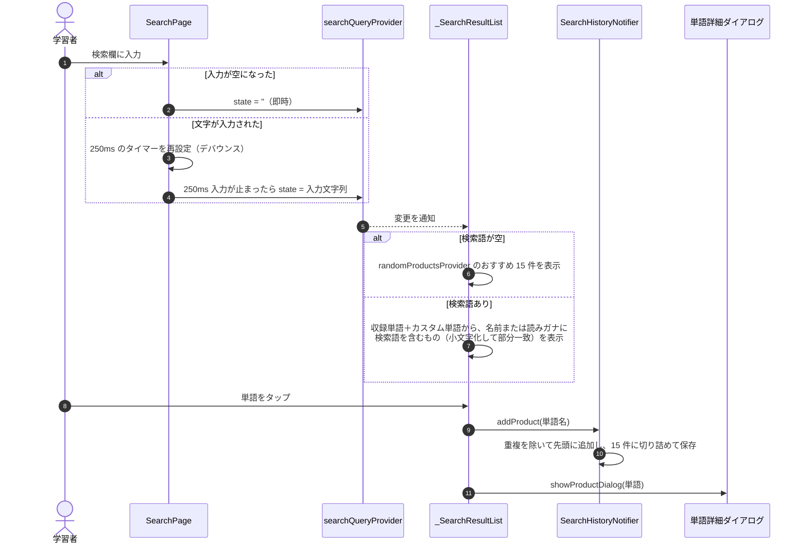

## 4.2 4 択クイズの生成

`generateQuizQuestions(quizPool, distractorPool, quizCount)`（`lib/utility/generate_quiz_questions.dart`）は、
単語テストとチェック問題テストで共通に使う、UI に依存しない関数です。

| 引数 | 単語テスト | チェック問題テスト |
| --- | --- | --- |
| `quizPool`（出題対象） | 収録単語すべて | 収録単語のうちチェック問題に登録したもの |
| `distractorPool`（誤答候補） | 収録単語すべて | 収録単語すべて |
| `quizCount` | 10（リワード獲得で＋10） | 10 |

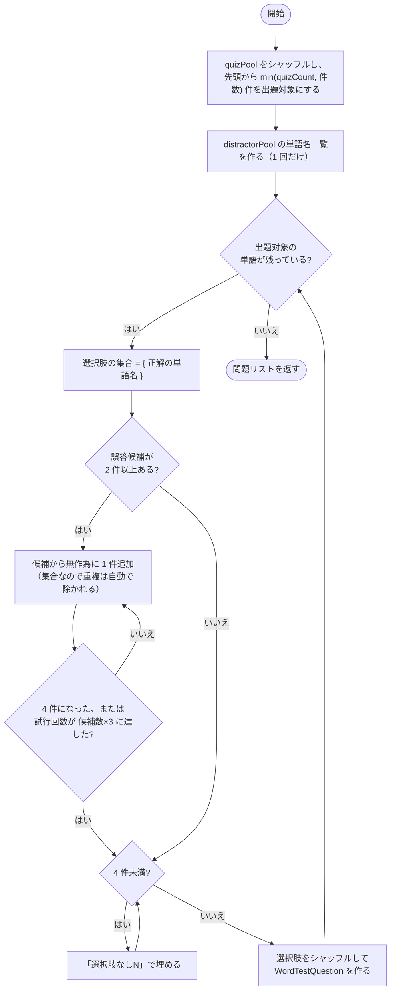

性質（`test/utility/generate_quiz_questions_test.dart` で検証）:

- 問題数は `min(quizCount, quizPool の件数)`
- 各問題の選択肢はちょうど 4 件で重複がなく、正解を必ず含む
- 誤答候補が足りなくても 4 択になる（ダミーで埋める）

## 4.3 単語テストの進行

`WordTestPage`（チェック問題テストの `CheckboxTestPage` も同じ流れ）の状態遷移です。

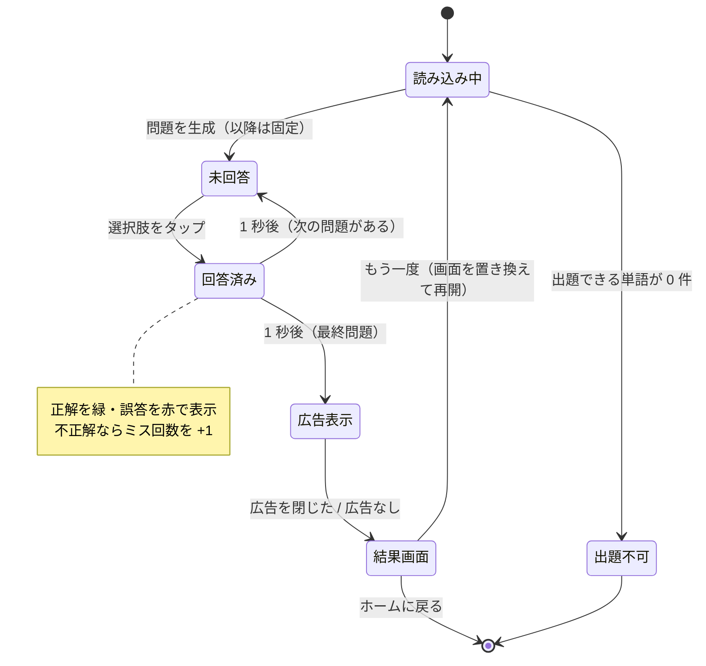

- 出題内容は、データが届いた最初の描画で 1 度だけ生成し（`_quiz ??= …`）、再描画では作り直しません。
- 画面を開いたときにインタースティシャル広告を先読みします（`AdManager.loadAd(AdType.interstitial)`）。

## 4.4 仕訳問題の出題

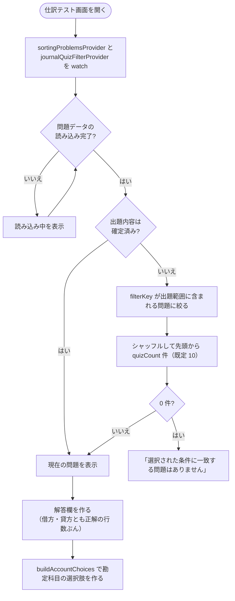

`buildAccountChoices(correctAccounts, master, minOptions = 10)`（`lib/provider/account_options_provider.dart`）:

1. 正解の勘定科目を集合に入れる（重複は除く）
2. 勘定科目マスタ（`accountOptionsProvider`: 全問題の勘定科目、165 種類）から正解以外を取り出してシャッフルする
3. 集合が `minOptions` 件になるまで誤答候補を追加する（マスタが足りなければ集まった分だけ）
4. 五十音（文字コード順）に並べて返す

並び順で正解が推測できないよう、正解と誤答を混ぜたうえでソートしています。
正解の科目しか並ばないと消去法で解けてしまうため、誤答候補を必ず混ぜます。

## 4.5 仕訳問題の採点

`JournalEntryQuizWidget._submitAnswer` の処理です。

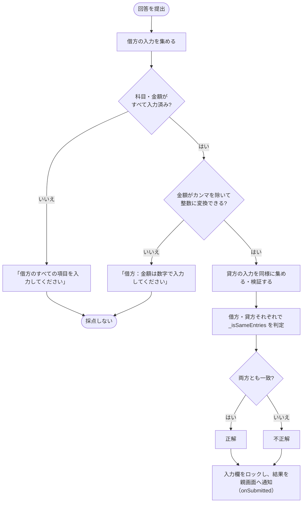

`_isSameEntries(ユーザーの入力, 正解)` は**並び順を問わない完全一致**です。

1. 行数が異なれば不一致
2. ユーザーの各行について、正解の残りから「科目と金額が両方一致する行」を探し、見つかれば取り除く。見つからなければ不一致
3. 最後に正解の残りが空なら一致

## 4.6 再挑戦とリワード広告

テスト結果画面の「もう一度」の処理です（単語テストと仕訳問題で共通の考え方）。

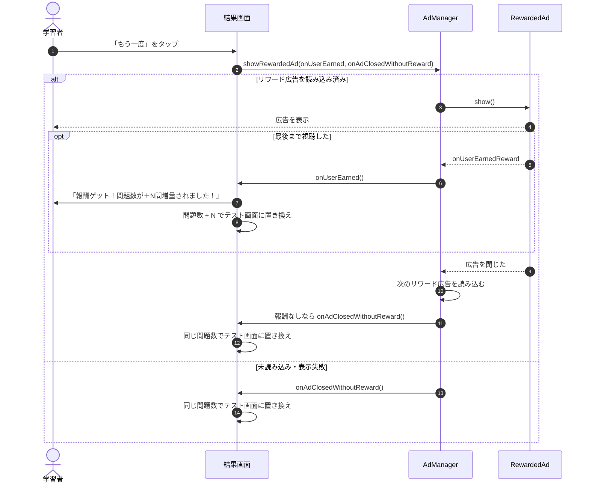

| テスト | 増える問題数 N | 広告 |
| --- | --- | --- |
| 単語テスト | ＋10 問 | リワード広告 |
| 仕訳問題 | ＋5 問 | リワード広告 |
| チェック問題テスト | — | 広告なしで同じ条件で再挑戦 |

## 4.7 スケジュール

### 予定の状態遷移

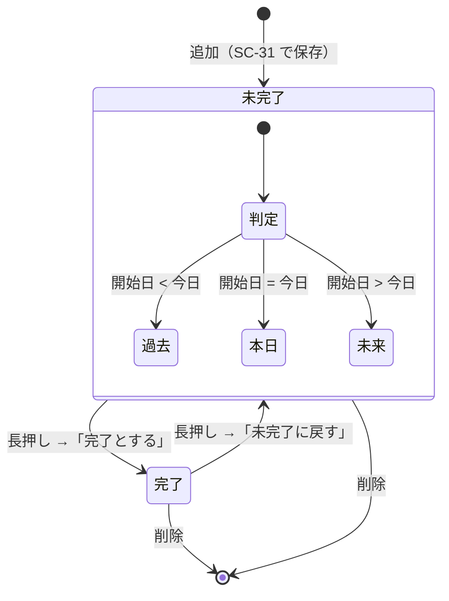

タスク一覧タブでは、未完了の予定を開始日で「過去 / 本日 / 未来」に分け、完了した予定は「完了タスク」にまとめます。

### 予定からタスク行への展開

1 件の `ScheduleItem` を、一覧表示用のタスク行（`_TaskEntry`）に展開します。

| 予定の内容 | 表示するタスク行 |
| --- | --- |
| `tasks` が 1 件以上 | `tasks` の各要素を 1 行ずつ |
| `tasks` が空の勉強予定 | 「勉強予定」1 行 |
| 受験日（`isExamDate = true`） | 上記に加えて「受験日」1 行 |

タスク行の削除:

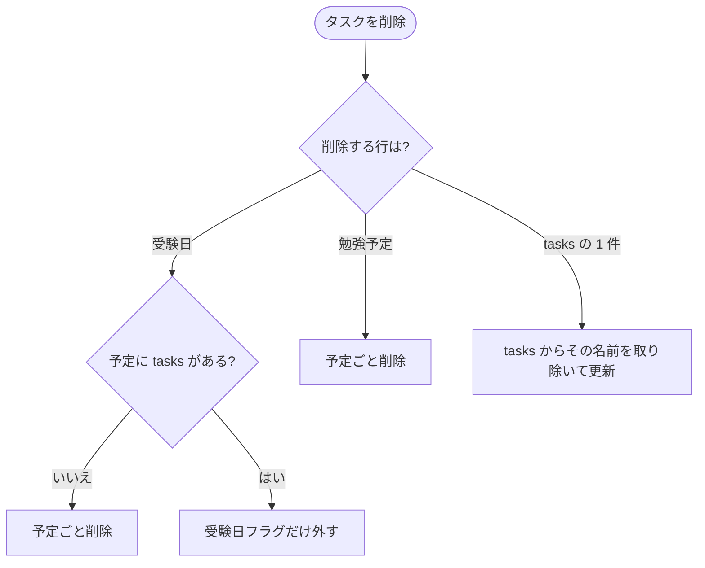

### 受験日の制約と残り日数

- 受験日は「今日より後の受験日」が 3 件まで（`_maxExamDates = 3`）。編集中の予定自体は数えない。
- 受験日として保存すると、終了日時は開始の 7 日後、`tasks` は空になります。
- 残り日数は `startTime.difference(現在時刻).inDays + 1` です（[既知の課題 #1](01_architecture.md#110-既知の課題)）。
- スケジュール管理画面の上部の受験日カードには、今後の受験日を日付順に最大 3 件表示します。

## 4.8 キャッシュクリア

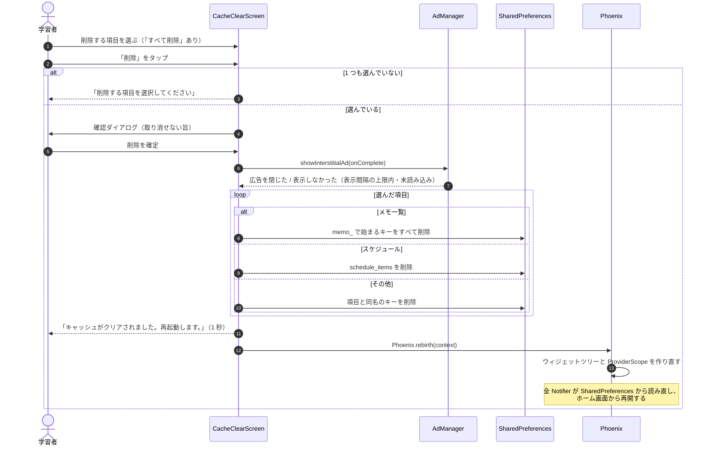

テーマ・Material 3・出題範囲・広告の表示時刻は削除の対象外です（[3.4](03_data_and_state.md#34-永続化データ設計sharedpreferences)）。

## 4.9 永続化 Notifier の読み込みと更新

起動直後、保存済みデータの読み込みが終わる前にユーザーが操作した場合の動きです（`SavedItemsNotifier` の例）。

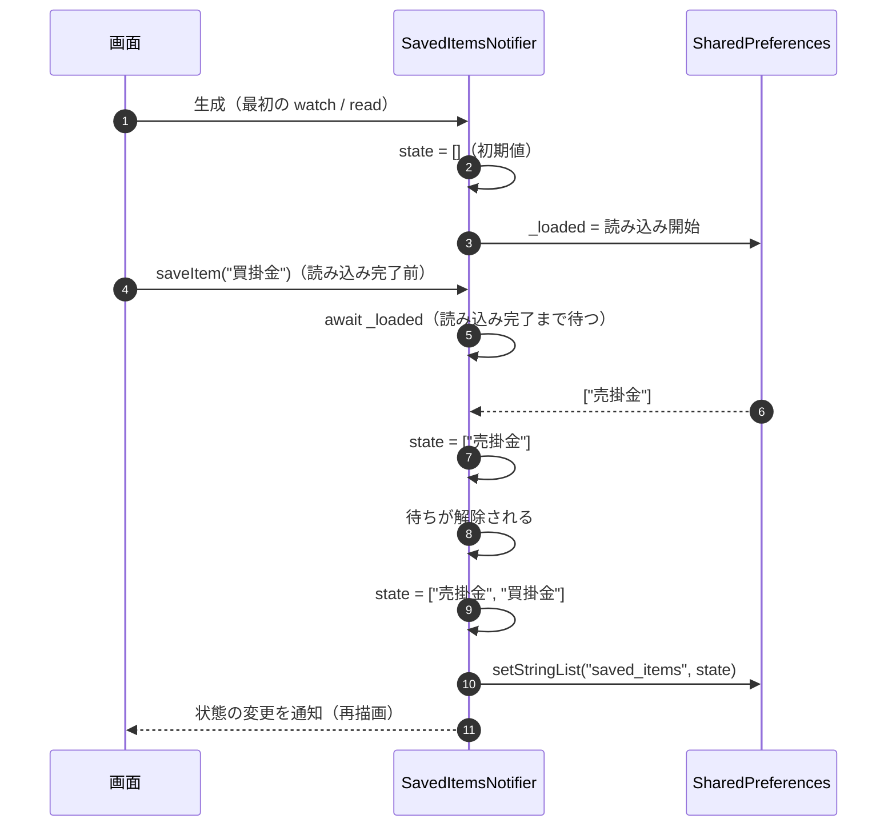

読み込みを待たずに更新すると、次のどちらかの不具合が起きます（`test/notifier/persisted_notifiers_test.dart` で回帰を防止）。

- 読み込み前の空の状態を基に保存してしまい、保存済みデータを消す
- 更新した状態を、後から届いた読み込み結果で上書きしてしまう（テーマ変更が元に戻るなど）

## 4.10 単語カードの画像共有

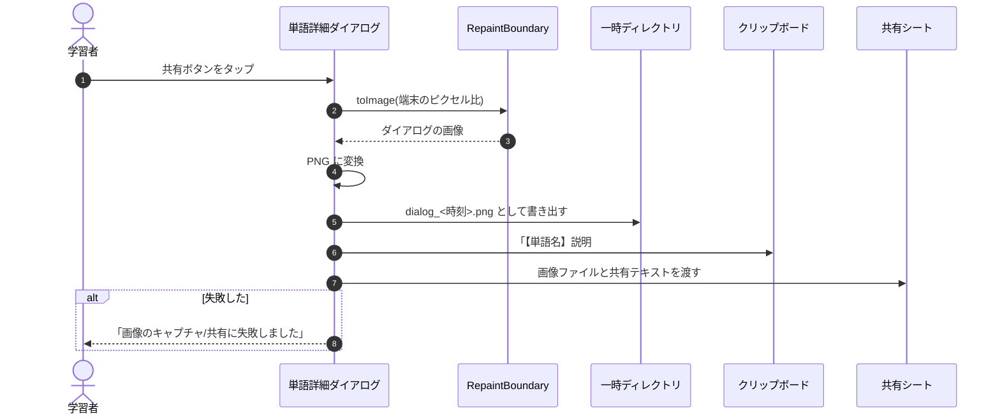

## 4.11 リストへの割り当て

単語の操作メニューの「保存する」で開くボトムシート（SC-06）の処理です。

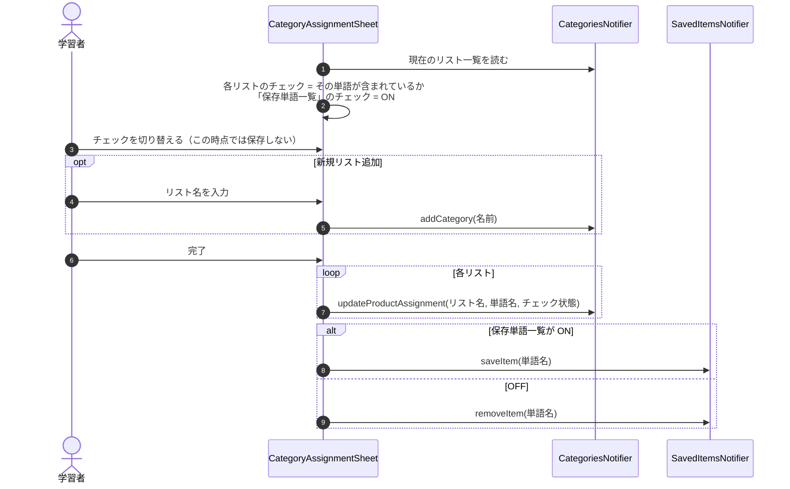

## 4.12 カスタム単語の追加

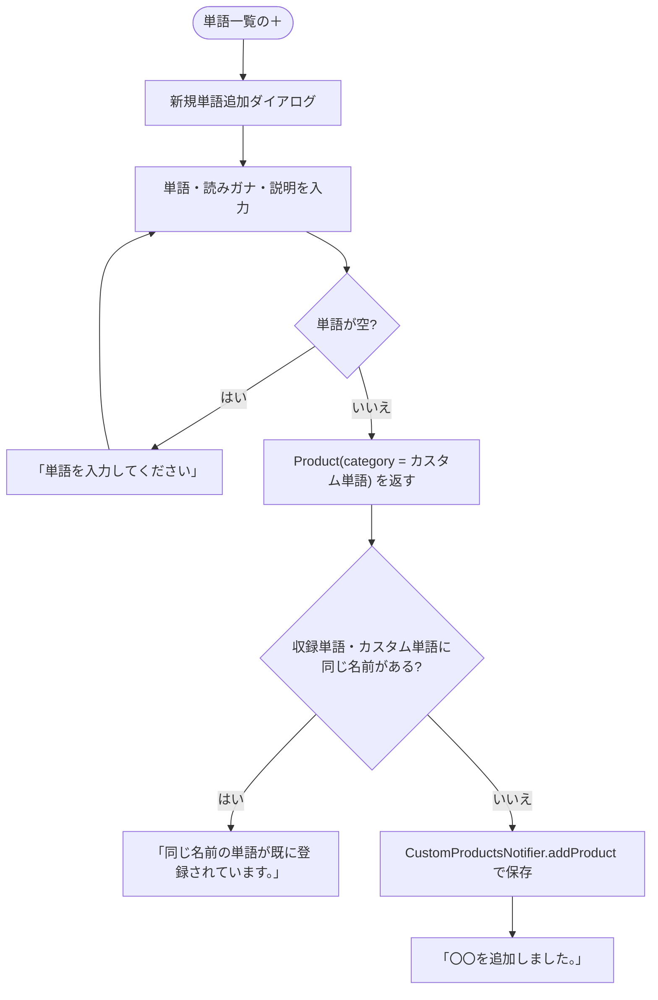

`CustomProductsNotifier.addProduct` 自身もカスタム単語同士の重複を確認し、重複時は `false` を返して保存しません。
