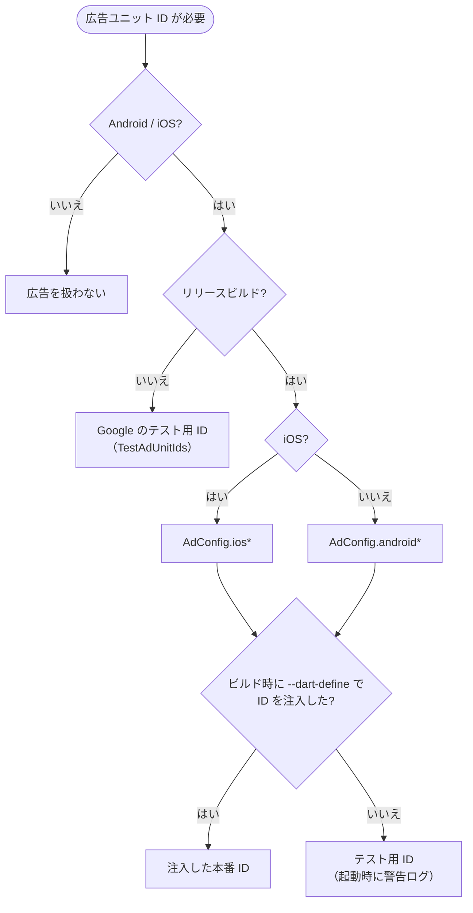
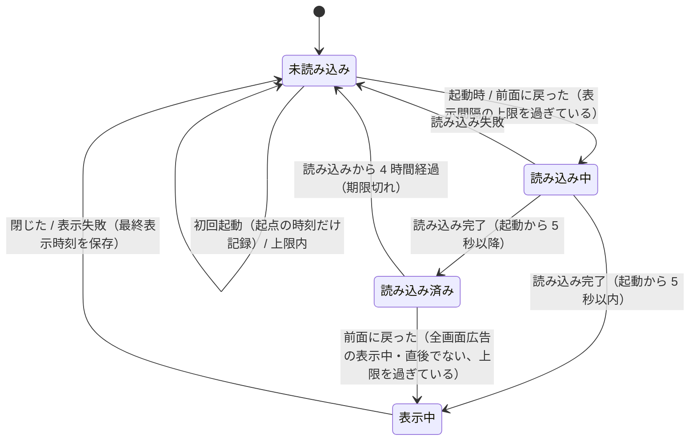
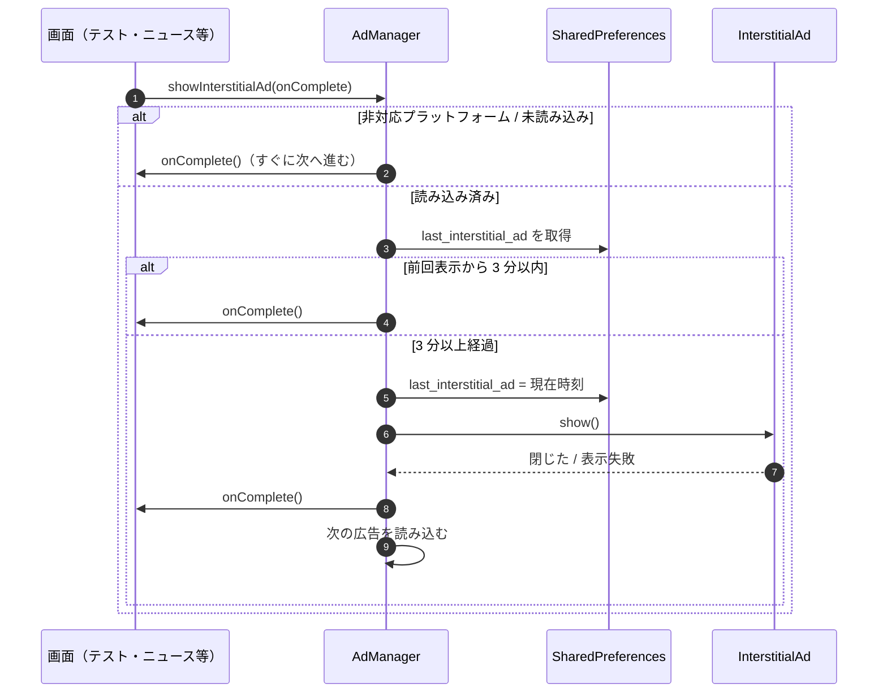
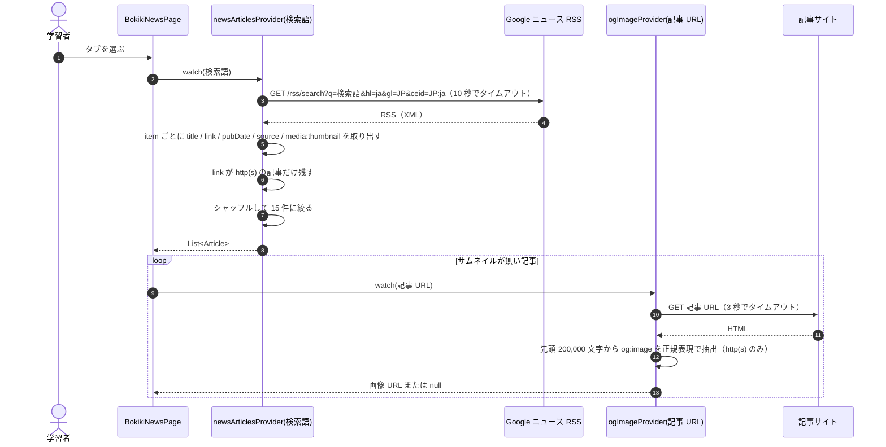
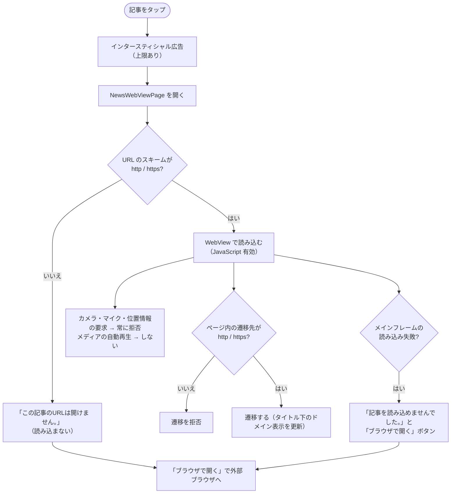

# 5. 広告・外部連携設計

[目次へ戻る](README.md)

## 5.1 広告の種類と表示箇所

広告は Google AdMob（`google_mobile_ads`）で配信し、`lib/ads/ad_manager.dart` の `AdManager` がすべての読み込みと表示を担います。
広告 SDK が動くのは Android と iOS だけで、それ以外（Web・デスクトップ）では何もしません（`AdManager.isSupported`）。

| 種類 | 表示する場面 | 表示間隔の上限 | 先読み |
| --- | --- | --- | --- |
| バナー | 単語検索（ホーム）の画面下部 | なし | 表示するウィジェット（`BannerAdView`）ごとに読み込む |
| インタースティシャル | 単語テスト・チェック問題テスト・仕訳テストの終了時、ニュース記事を開くとき、キャッシュクリアの実行時 | 前回表示から 3 分 | 起動時、各画面を開いたとき、広告を閉じた直後 |
| リワード | テスト結果画面の「もう一度」（単語テスト・仕訳問題） | なし（ユーザーの操作でのみ表示） | 起動時と、広告を閉じた直後 |
| App Open | 起動時（読み込みが 5 秒以内に終わった場合）と、アプリが前面に戻ったとき | 前回表示から 2 時間。初回起動では表示しない | 起動時と、前面に戻ったとき |

設計上の方針:

- **広告が無くても機能を止めない。** 未読み込み・読み込み失敗・表示失敗のときは、広告を出さずにすぐ次の処理（画面遷移や再挑戦）へ進みます。
- **全画面広告を連続させない。** 全画面広告の表示中と、閉じてから 2 秒間は App Open 広告を出しません（広告を閉じるとアプリが「前面に戻った」扱いになるため）。
- **表示時刻は端末に保存する。** 上限の判定に使う最終表示時刻は SharedPreferences（`last_interstitial_ad` / `last_app_open_ad`）に保存し、アプリを再起動しても間隔を守ります。

## 5.2 広告ユニット ID の決定

| 設定 | 渡し方 | ファイル（Git 管理外） |
| --- | --- | --- |
| 広告ユニット ID（8 種類） | `flutter build ... --dart-define-from-file=dart_defines.json` | `dart_defines.json`（雛形: `dart_defines.example.json`） |
| AdMob アプリ ID（Android） | `android/app/build.gradle` が読み、`AndroidManifest.xml` の `${admobAppId}` に差し込む | `android/admob.properties`（雛形: `android/admob.properties.example`） |
| AdMob アプリ ID（iOS） | `ios/Runner/Info.plist` の `GADApplicationIdentifier` | 現在はテスト用 ID のまま |

## 5.3 App Open 広告の状態遷移

## 5.4 インタースティシャル広告の表示

## 5.5 簿記ニュース

### 記事一覧の取得

| 状況 | 動作 |
| --- | --- |
| HTTP ステータスが 200 以外・通信エラー・タイムアウト | エラー文と「再読み込み」ボタンを表示（Riverpod 3 の既定で自動再試行もされる） |
| 引っ張って更新 / 再読み込み | `ref.invalidate(newsArticlesProvider(検索語))` で取得し直す |
| `og:image` の取得失敗 | 例外を外に出さず `null`（サムネイルなし）として扱う |

### 記事の閲覧（WebView）

## 5.6 外部リンク

| 機能 | 開く先 | 開き方 | 失敗時 |
| --- | --- | --- | --- |
| フィードバック（SC-58） | Google フォーム（`https://forms.gle/…`） | `url_launcher`（外部アプリ） | 「フィードバックフォームを開けませんでした」 |
| 仕訳問題の問い合わせ（SC-25 / SC-28） | Google フォーム | 問題 ID をコピーしてからでないとボタンが押せない（どの問題か特定するため） | 同上 |
| 記事をブラウザで開く（SC-41） | 記事 URL | `url_launcher`（外部アプリ） | 「ブラウザを開けませんでした」 |
| 単語カードの共有（SC-03） | 端末の共有シート | `share_plus` | 「画像のキャプチャ/共有に失敗しました」 |

## 5.7 Web 公開物

プライバシーポリシーの Web ページと `app-ads.txt`（AdMob の認定販売者の宣言）は、アプリとは別に静的ファイルとして Web 上で公開しています。
実際の販売者 ID を含むため、これらのファイルとデプロイ設定は本リポジトリ（公開版）に含めていません。
アプリ内に同梱するプライバシーポリシーの本文は `assets/privacypolicy.txt` です。
