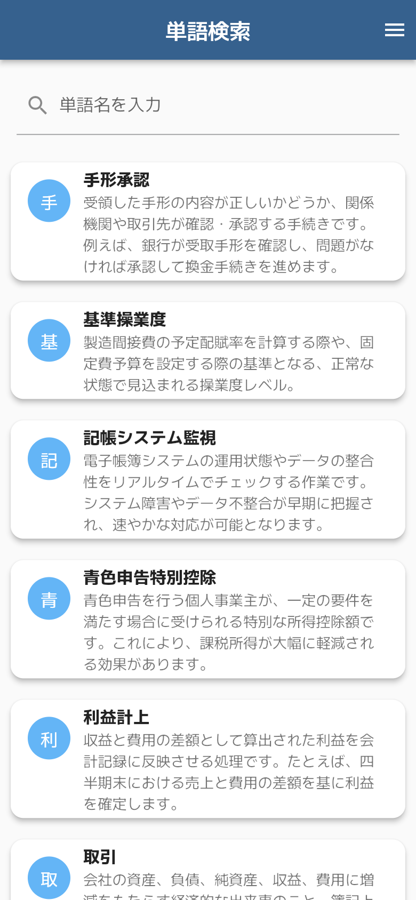
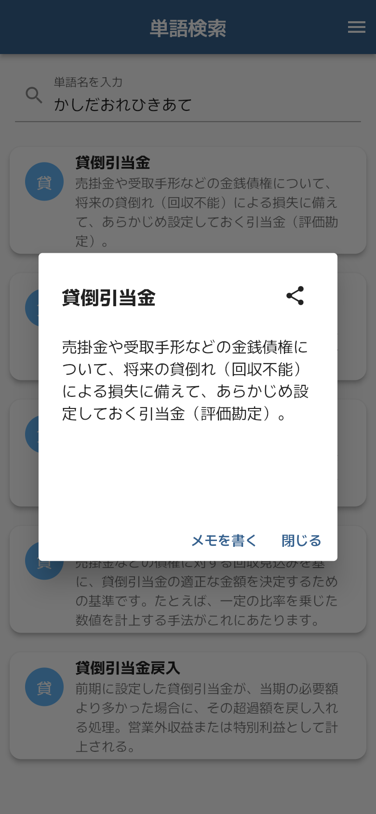
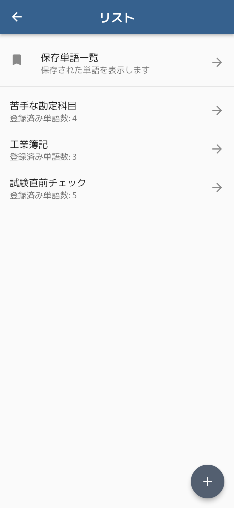
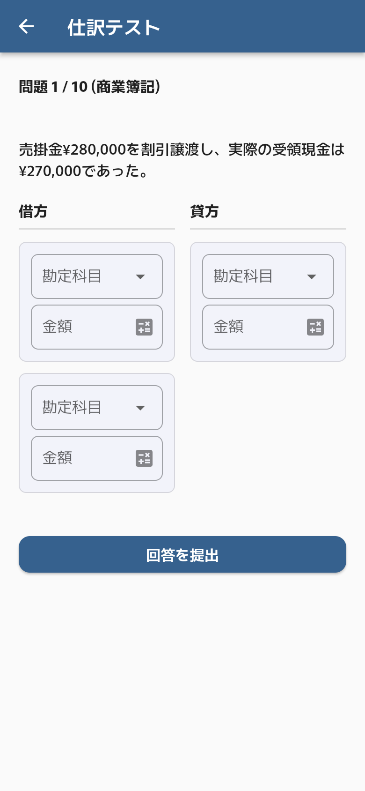

# 簿記単
簿記の勉強に、頼れる強い味方。


## 概要 (Overview)
「簿記単」は、簿記の資格取得を目指すすべての学習者のための、簿記用語に特化した単語帳アプリケーションです。

簿記の学習中、「参考書の索引に載っていない」「ネットで検索すると情報が多すぎる」といった自身の経験から、効率的に語彙力を強化できる専門アプリの必要性を感じ、開発に至りました。

このアプリ一つで、単語の検索から暗記、クイズでの実力試し、学習スケジュールの管理までをサポートします。


| 検索 | 単語詳細 | マイリスト | 単語テスト | 仕訳クイズ |
| --- | --- | --- | --- | --- |
|  |  |  |  |  |

| 項目 | 内容 |
| --- | --- |
| 開発時期 | 2025-05〜2025-07（初期開発）、2026-07・2026-10（改修・リリース準備・ドキュメント整備）※コミット記録による |
| 対象 | Android（Flutter 製。iOS もビルドは可能） |
| 公開状況 | Google Play で公開済み（[ストアページ](https://play.google.com/store/apps/details?id=com.bokitan.bookkeeping_vocabulary_notebook)） |
| 公開版について | 非公開リポジトリから、採用評価に必要なものだけを履歴なし（1 コミット）で移植した公開版です。Firebase Hosting 関連、Web 版、`app-ads.txt` を含む `public/` は含めていません |
| データの出所 | 単語の意味（`assets/products.json`）と仕訳問題（`assets/siwake.json`）の文章は、すべて生成 AI に依頼して作成したもので、第三者の著作物は含みません。仕訳問題は貸借一致などをテストで検証しています |
| 開発体制 | 個人開発。Claude Code を使用（[開発について](#開発について-development)） |

**ドキュメント**

| 文書 | 内容 |
| --- | --- |
| [3 分で読める概要](Doc/README.md) | 伝えたいこと、技術的課題と解決、主要画面のスクリーンショット |
| [要件定義書](Doc/requirements.md) | 目的・対象範囲、機能要件、非機能要件 |
| [画面定義書](Doc/screen-definitions.md) | 画面ごとの表示項目・操作・入力チェック・遷移先 |
| [詳細設計書](Doc/design/README.md) | アーキテクチャ、データ・状態管理、処理設計（UML 図つき） |
| [テスト報告書](Doc/test-report.md) | 自動テスト 34 件の内容と実行結果 |


## 主な機能 (Features)

📚 **豊富な単語データベース**

- 簿記・会計用語を **1,373語** 収録しています。
- 仕訳問題を **270問** 搭載しており、より実践的な学習が可能です。

🔍 **高速な検索機能**

- 単語名や読みガナから、必要な情報を素早く見つけ出せます。
- 検索履歴から、過去に調べた単語をすぐに確認できます。

✍️ **パーソナライズ学習機能**

- **マイリスト管理**: 重要な単語や苦手な単語を自由にグループ化・保存できます。ドラッグ＆ドロップで直感的に並び替えも可能です。
- **メモ機能**: 各単語に独自のメモを残し、理解を深めることができます。
- **カスタム単語**: データベースにない単語を、単語一覧画面から自分で追加できます。

🧠 **単語テスト＆クイズ**

- **4択クイズ**: 収録単語全体、または自分でチェックした単語のみを対象に、4択クイズで知識の定着度を確認できます。
- **仕訳問題クイズ**: 借方・貸方の勘定科目と金額を入力する、より実践的なクイズに挑戦できます。勘定科目の選択肢には全問題から集めた誤答候補が混ざるため、消去法では解けません。金額入力欄からは電卓を呼び出せます。
- **出題範囲の設定**: 「簿記3級-商業簿記」「簿記2級-商業簿記」「簿記2級-工業簿記」から出題範囲を選べます。
- **ミス回数記録**: 間違えた問題の回数が記録され、苦手な単語を効率的に克服できます。

🗓️ **学習スケジュール管理**

- カレンダーで学習予定とタスクを管理できます。
- 受験日を最大3件まで登録でき、試験までの残り日数を表示します。
- タスクは「過去 / 本日 / 未来 / 完了」に分類して一覧表示されます。

📰 **簿記ニュース**

- 簿記3級・2級・1級・会計関連のニュースを Google ニュースから取得して閲覧できます。

🎨 **柔軟なカスタマイズ**

- **テーマ設定**: ライトモード、ダークモード、システム設定追従から選べます。
- **Material 3 対応**: 最新のUIデザインに対応し、ON/OFFの切り替えが可能です。
- **キャッシュクリア**: 検索履歴・ミス回数・マイリスト・メモ・スケジュールなどを項目ごとに削除できます。

🤝 **共有機能**

- 学習した単語カードを画像としてSNSなどで簡単に共有できます。


## こだわった点・アピールポイント (Highlights)

**状態管理に Riverpod を採用**

`StateNotifierProvider`, `FutureProvider`, `Provider` などを機能やデータの特性に応じて使い分け、宣言的でリアクティブな状態管理を実装しています。UI とビジネスロジックをクリーンに分離し、保守性とテストの容易性を高めています。

**UI/UXへのこだわり**

`Dismissible` や `GestureDetector` を用いたスワイプでの削除、長押しでのコンテキストメニュー表示を実装しました。また `BuildContext` の拡張機能（`ResponsiveSizes`）を作成し、画面サイズに応じたレスポンシブなUIを実現しています。

**コンポーネントの再利用性**

`ProductCard` や `CommonProductListView` といった共通ウィジェットを作成し、アプリ全体で一貫性のあるUIを提供すると同時に、コードの重複を削減しています。仕訳問題の解答UIは、クイズ画面と問題詳細画面で同じウィジェットを共有しています。

**起動時のもたつきを避ける工夫**

約 500KB の単語 JSON と約 190KB の仕訳 JSON のパースは `compute()` で別 isolate に逃がし、UI スレッドを止めないようにしています。検索入力はデバウンスして絞り込みの実行回数を抑えています。

**柔軟なデータ永続化**

`shared_preferences` を活用し、テーマ設定・マイリスト・メモ・クイズのミス回数・学習スケジュールなど、多岐にわたるユーザーデータを永続化しています。


## 開発について (Development)

本作品は **Claude Code（Anthropic の AI コーディングツール）を使って開発**しています。

| 担当 | 内容 |
| --- | --- |
| 自分で行ったこと | 企画（簿記学習中の自身の困りごとから着想）、機能と仕様の決定、設計判断（状態管理・データの持ち方・広告の出し方など）、Claude Code が作成した変更のレビューと採否の判断 |
| Claude Code に任せたこと | 指示に基づくコードの実装・リファクタリング、テストコードの作成、ドキュメント（設計書・本 README 等）の下書き |

コミット記録上、Claude が作成者・共同作成者として記録されているのは 2026-07 以降のコミットです。

## 使用技術 (Tech Stack)

| 分類 | 使用技術 |
| --- | --- |
| Framework | Flutter |
| Language | Dart |
| State Management | flutter_riverpod |
| Local Storage | shared_preferences |
| Routing | MaterialPageRoute |
| 収益化 | google_mobile_ads (AdMob) |

**主なライブラリ**

- `intl`: 日付・数値のフォーマット処理
- `table_calendar`: スケジュール管理のカレンダー表示
- `math_expressions`: 電卓機能
- `share_plus` / `path_provider`: 単語カード画像のSNS共有
- `http` / `xml`: 簿記ニュース（RSS）の取得
- `webview_flutter`: ニュース記事の閲覧
- `url_launcher`: 外部リンク起動
- `flutter_phoenix`: キャッシュクリア後のアプリ再起動


## ディレクトリ構成 (Structure)

```
lib/
├── main.dart          # エントリーポイント（初期化とテーマ設定のみ）
├── ads/               # AdMob 広告の読み込み・表示
├── notifier/          # StateNotifier（永続化を伴う状態の更新ロジック）
├── provider/          # Riverpod の Provider 定義
├── utility/           # データモデルと共通ユーティリティ
└── view/              # 画面
    ├── category_page/ # マイリスト
    ├── schedule_page/ # 学習スケジュール
    ├── setting_page/  # 設定
    ├── test_page/     # 単語テスト・仕訳問題
    └── widget/        # 共通ウィジェット
```


## セットアップ (Setup)

```bash
flutter pub get
flutter run
```

**テストの実行**

```bash
flutter test
```

**リリースビルドについて**

リリースビルドには、Git 管理外の設定ファイルが 3 つ必要です。いずれも無い場合はフォールバックが効くためビルド自体は通りますが、**ストア配信には使えません**（デバッグ署名・テスト広告になります）。

| ファイル | 用途 | 雛形 |
| --- | --- | --- |
| `android/key.properties` | Android の署名情報 | – |
| `android/admob.properties` | AdMob の**アプリ ID** | `android/admob.properties.example` |
| `dart_defines.json` | AdMob の**広告ユニット ID** | `dart_defines.example.json` |

`android/key.properties` の形式:

```properties
storePassword=<パスワード>
keyPassword=<パスワード>
keyAlias=<エイリアス>
storeFile=<キーストアファイルへのパス>
```

ビルドコマンド:

```bash
flutter build apk --release --dart-define-from-file=dart_defines.json
# または
flutter build appbundle --release --dart-define-from-file=dart_defines.json
```

> **Note**
> 広告ユニット ID は暗号鍵のような秘密情報ではなく（APK を解析すれば誰でも取得できます）、外部ファイル化しているのは公開リポジトリに収益用 ID を載せないための運用上の配慮です。デバッグビルドでは常に Google のテスト用 ID が使われます。

> **Note**
> iOS 版の AdMob 設定（`ios/Runner/Info.plist` の `GADApplicationIdentifier`）は、現在 Google 公式のテスト用アプリ ID のままです。iOS を配信する際は AdMob で発行した iOS 用アプリ ID と広告ユニット ID に差し替えてください。
